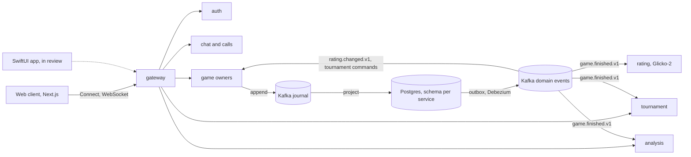

# Axon

Realtime game platform in Go: an event-sourced game service on a Kafka journal,
CDC-driven rating, Stockfish analysis and a tournament saga, plus chat and calls,
with mTLS, rotating JWT keys and end-to-end tracing, each verified by load, chaos
and e2e runs.

[](https://github.com/Bvivg/axon/actions/workflows/ci.yml)

Chess, Quoridor and tic-tac-toe online with matchmaking, spectators, replay and
tournaments; chat with media and search; 1:1 and group calls. Seven Go services
behind one Connect gateway, a Next.js web client, Docker Compose and a kind +
Argo CD Kubernetes setup.

## What's hard here

- **Event-sourced game writes.** A move is accepted once it is appended to a
  Kafka journal by the single owner of its partition; Postgres is a projection.
  Against the old `SELECT … FOR UPDATE` path on 20,000 matches: 803 → 1,524
  moves/s, p50 277 → 77 ms, read model reconciled 683,639 = 683,639 moves
  ([phase 1](.claude/plans/platform-phase-1-game-event-sourcing.md)).
- **Ownership with leases and fencing.** `docker kill` of the owner of 12
  partitions during 50 chess games: 3,937 confirmed moves = 3,937 in the read
  model, failover pause about 11 s
  ([phase 1](.claude/plans/platform-phase-1-game-event-sourcing.md)).
- **A profiled performance pass.** Compact events, a batched projector and
  bitset Quoridor walls: p99 335 → 19 ms, game CPU per 1,000 moves/s 1.17 → 0.58
  cores, projector lag 10 s → 1 s
  ([phase 1b](.claude/plans/platform-phase-1b-game-performance.md)).
- **Chaos with exact reconciliation.** 4,000 games under Postgres latency, a
  Redis outage and rolling restarts: a lease-flapping bug found and fixed, then
  3,999/4,000 games completed and matching the database, 0 lost confirmed moves
  ([phase 3](.claude/plans/platform-phase-3-scale-resilience.md)); the same in
  Kubernetes under Chaos Mesh, 3,999 = 3,999 with HPA 2 → 4 → 2
  ([phase 6](.claude/plans/platform-phase-6-k8s-gitops.md)).
- **Exactly-once effects over at-least-once CDC.** Transactional outbox,
  Debezium and deterministic event ids: with Debezium stopped for 60 s under
  load, 50 rated games were each counted exactly once and the rating rebuilt from
  the topic matched live state
  ([phase 2](.claude/plans/platform-phase-2-outbox-cdc.md)).
- **Zero-downtime security mechanics.** JWT signing keys rotate on their own:
  81,310 authenticated calls during rotation, 0 rejections; 1-hour mTLS
  certificates with per-service allow-lists
  ([phase 5](.claude/plans/platform-phase-5-security.md)).

## Architecture



Diagrams of the move path, partition ownership, the tournament saga, network
zones and the Kubernetes setup are in [docs/architecture.md](docs/architecture.md).
Decision records: [docs/adr/README.md](docs/adr/README.md).

## Quick start

Needs Docker with Compose v2, `make` and `bash`. Code generation, key generation
and every service run in containers.

```sh
make proto && ./startup.sh
```

`make proto` generates the contracts the images compile against; `startup.sh`
creates `core/deploy/.env`, a development signing key, and starts the whole
stack. The web client is at `http://localhost:3003`, the gateway at
`http://localhost:18080`; create an account on the sign-up page.

For the local hot-reload launcher, the Compose overlays and the Kubernetes
targets, see [docs/development.md](docs/development.md) and
[core/deploy/README.md](core/deploy/README.md).

## Proof

| Claim | Command or test | Result |
|---|---|---|
| Handovers never lose an accepted command | `make test`, [`TestSimulatedHandoversNeverLoseAcceptedCommands`](core/services/game/internal/owner/owner_test.go) | 20 seeds × 400 steps × 3 nodes ([phase 1](.claude/plans/platform-phase-1-game-event-sourcing.md)) |
| Killing an owner loses no acknowledged move | `docker kill` of the owner during 50 chess games, 3 brokers, game ×2 | 3,937 = 3,937 confirmed moves ([phase 1](.claude/plans/platform-phase-1-game-event-sourcing.md)) |
| Journal beats row locks | [`loadgen`](core/services/game/cmd/loadgen), 20,000 matches, 300 concurrent, A/B | 803 → 1,524 moves/s, p99 1,144 → 604 ms ([phase 1](.claude/plans/platform-phase-1-game-event-sourcing.md)) |
| Compact events and batched projection | `loadgen`, 6,000 matches, 1,000 concurrent | p50/p95/p99 23/184/335 → 2/8/19 ms ([phase 1b](.claude/plans/platform-phase-1b-game-performance.md)) |
| Chaos in Compose | [`core/deploy/chaos/scenario.sh`](core/deploy/chaos/scenario.sh) under `loadgen`, 4,000 games | 3,999/4,000 completed, 0 lost confirmed moves ([phase 3](.claude/plans/platform-phase-3-scale-resilience.md)) |
| Exactly-once rating through CDC | `make test-rating-e2e`, [`chain_test.go`](core/services/rating/e2e/chain_test.go) | 50 games, 45 finished with Debezium stopped, each counted once; rebuild over 51 events exits 0 ([phase 2](.claude/plans/platform-phase-2-outbox-cdc.md)) |
| mTLS and key rotation | `make test-e2e-security`, [`core/shared/e2e/security`](core/shared/e2e/security) | plain HTTP, no certificate and an `intruder` certificate from the same CA rejected; 81,310 calls during rotation, 0 rejections, 4 keys ([phase 5](.claude/plans/platform-phase-5-security.md)) |
| One trace per move | observability overlay | one trace ID for `gateway.ws move → game.command → journal.append → projector.apply` ([phase 4](.claude/plans/platform-phase-4-observability.md)) |
| Stockfish analysis via CDC | `make test-e2e-analysis`, [`analysis_test.go`](core/services/analysis/e2e/analysis_test.go) | report ready 3.05 s and 5.17 s after mate, `g8f6` marked as a blunder ([phase 7b](.claude/plans/platform-phase-7b-analysis.md)) |
| Tournament saga is idempotent | [`tournament/integration`](core/services/tournament/integration/saga_test.go) | 18 deliveries of `game.finished.v1` across an orchestrator restart: 7 applied, 11 duplicates ([phase 7c](.claude/plans/platform-phase-7c-tournaments.md)) |
| A bracket finishes end to end | `make test-e2e-tournament`, [`tournament_test.go`](core/services/tournament/e2e/tournament_test.go) | 8 players with one no-show, start to `finished` in 39.4 s ([phase 7c](.claude/plans/platform-phase-7c-tournaments.md)) |
| Chaos and autoscaling in Kubernetes | `make kind-chaos`, [`workflow.yaml`](core/deploy/k8s/chaos/workflow.yaml) | 3,999 = 3,999, 0 lost acknowledged moves, HPA 2 → 4 → 2 ([phase 6](.claude/plans/platform-phase-6-k8s-gitops.md)) |
| e2e inside the cluster | `make kind-e2e` | auth 62/0, chat 26/0, rating 2/0, security 17/0 ([phase 6](.claude/plans/platform-phase-6-k8s-gitops.md)) |
| Manifests are valid | `make k8s-validate`, in CI | 161 manifests, 0 errors ([phase 6](.claude/plans/platform-phase-6-k8s-gitops.md)) |

Results are recorded in each phase plan's results section at the time of the
run. Benchmark tables and invocations: [docs/benchmarks.md](docs/benchmarks.md).

## Services

| Service | Responsibility | Storage | Events in | Events out |
|---|---|---|---|---|
| `gateway` | Trust boundary: Connect and WebSocket proxy, local JWT checks through JWKS, CORS, GCRA rate limits, refresh cookie | edge Redis for rate limits | — | — |
| `auth` | Password and OAuth sign-in, refresh rotation with reuse detection, roles, rotating JWKS | Postgres `auth`, Redis | — | `auth.user.registered.v1`, `auth.audit.v1` |
| `chat` | Rooms, messages, media, search, push; the Calls module ([ADR-1](docs/calls.md)) | Postgres `chat`, Redis, MinIO | — | `chat.message.v1`, `call.ended.v1` |
| `game` | Chess, Quoridor, tic-tac-toe; partition owners, journal, projector, matchmaking, spectators, replay | Kafka `game.session-events.v1` and `game.partition-leases.v1`; Postgres `game` read model | `rating.changed.v1`, `tournament.round_started.v1`, `tournament.forfeit.v1`, `tournament.cancelled.v1` | `game.finished.v1` |
| `rating` | Glicko-2 ratings, leaderboard, rebuild from the topic | Postgres `rating`, Redis | `game.finished.v1` | `rating.changed.v1` |
| `analysis` | Stockfish review of finished chess games | Postgres `analysis` | `game.finished.v1` | — |
| `tournament` | Single-elimination and Swiss tournaments as a saga | Postgres `tournament` | `game.finished.v1`, `rating.changed.v1` | `tournament.round_started.v1`, `tournament.forfeit.v1`, `tournament.cancelled.v1`, `tournament.finished.v1` |

Every outgoing domain event is written to the service's outbox table in the same
transaction as the state change and published by Debezium.

## Tech stack

- **Backend:** Go 1.27 multi-module workspace, Connect (buf), `coder/websocket`,
  franz-go, pgx, go-redis.
- **Data:** Postgres 17 with a schema and login role per service, Redis 7, Kafka,
  Debezium 3.7 with the outbox event router, Apicurio Registry, MinIO.
- **Web:** Next.js 16, React 19, Connect-Web, TanStack Query, shadcn on Base UI,
  Tailwind 4, Vitest, Playwright.
- **Calls:** native WebRTC with coturn for 1:1, self-hosted LiveKit for groups.
- **Analysis:** Stockfish over UCI.
- **Operations:** OpenTelemetry, Prometheus, Grafana, Tempo, Loki, Alloy,
  Pyroscope; step-ca, Envoy, PgBouncer, Toxiproxy.
- **Kubernetes:** kind, Helm, Argo CD, CloudNativePG, Strimzi, Redis Operator,
  cert-manager, prometheus-adapter, Chaos Mesh.
- **CI:** GitHub Actions with golangci-lint, govulncheck, `buf breaking`,
  testcontainers, Trivy, Syft SBOMs and cosign.

## How it was built

Axon was developed with AI coding agents working under explicit, versioned rules
in [`.claude/rules/`](.claude/rules/). Each stage or phase starts with a written
plan in [`.claude/plans/`](.claude/plans/): context, the chosen approach, the
files touched, how it is verified and a done criterion. The plan ends with a
results section recording what was measured and what was not verified. The
plans are in Russian; every number in this README is taken from one of them and
links to it. Scope decisions are recorded as owner decisions in the plans, for
example keeping Calls inside Chat.

## Status

Done: auth and gateway, chat, calls (1:1 P2P, groups on LiveKit, P2P-to-SFU
migration), chess, Quoridor and tic-tac-toe, and the platform phases 1–7c:
event sourcing, performance, outbox and CDC, scaling and resilience,
observability, security, Kubernetes and GitOps, spectators and replay, Stockfish
analysis, tournaments. See the [roadmap](.claude/plans/roadmap.md).

In review: the native iOS/macOS client in SwiftUI,
[PR #25](https://github.com/Bvivg/axon/pull/25).

Known gaps, as recorded in the plans:

- CI runs unit, integration, the auth and chat e2e, the Playwright suite, the
  calls media e2e and the Kubernetes manifest checks. The security, rating, game,
  analysis and tournament e2e suites and the chaos runs are `make` targets run
  by hand.
- The mTLS overlay has not been combined with the observability and SFU overlays
  ([phase 5](.claude/plans/platform-phase-5-security.md)).
- The Kubernetes stack covers auth, chat, game, gateway, rating and web;
  analysis, tournament and calls run in Compose only
  ([phase 6](.claude/plans/platform-phase-6-k8s-gitops.md)).
- Swiss tournaments are covered by unit tests only, and the leaderboard is not
  exposed through the gateway
  ([phase 7c](.claude/plans/platform-phase-7c-tournaments.md),
  [phase 2](.claude/plans/platform-phase-2-outbox-cdc.md)).
- The game journal topic keeps the broker's default retention in Compose, so the
  Postgres read model is the long-term record of finished games.
- Calls were not checked behind an external NAT or with push delivery, and
  Safari on iOS has only a partial manual check
  ([roadmap](.claude/plans/roadmap.md), [calls](docs/calls.md)).

## Repository

```
core/services/   one Go module per service
core/shared/     contracts (proto), shared packages, cross-service e2e
core/deploy/     Compose stack and overlays, CDC, chaos, observability, k8s
ui/web/          Next.js client
docs/            architecture, development, calls, runbooks
.claude/         agent rules and phase plans
```
