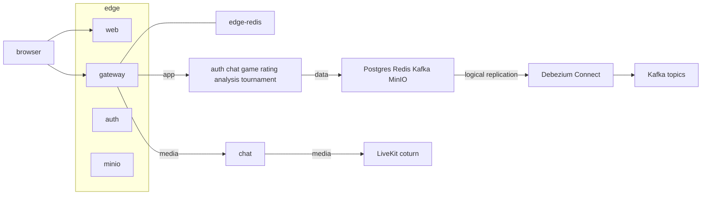

# core/deploy

Everything needed to run Axon outside a developer's editor: one base Compose stack, overlays that add heavy modes on top of it, self-contained test stacks, and the Kubernetes setup in [`k8s/`](k8s/). Heavy modes are opt-in overlays, never the default.

Run every command from the repository root. Overlays are added with extra `-f` flags after the base file; Compose resolves paths relative to `core/deploy`.

## Compose files

### Base

| File | Project | Purpose |
|---|---|---|
| `docker-compose.yml` | `axon` | The review stack. Postgres (`wal_level=logical`), Redis, `edge-redis`, MinIO, one Kafka broker, auth, chat, game, rating, analysis, tournament, gateway, web, per-service migration jobs, `postgres-schemas`, Debezium Connect with `cdc-setup` and `cdc-connector`, Apicurio `registry` with `schema-register`. `make up` starts it. |
| `docker-compose.tools.yml` | `axon-tools` | Toolchain containers: `go`, `buf`, `golangci-lint`, `promtool`, `trivy`, `syft`, `node`. Used by the Makefile and CI; never composed with the stack. |

### Overlays on the base stack

| File | Adds or changes | Used by |
|---|---|---|
| `docker-compose.ha.yml` | Kafka ×3 (RF 3, `min.insync.replicas` 2), two replicas of gateway, auth, chat and game, Envoy in front of gateway, a streaming Postgres replica, PgBouncer in transaction mode, game leases on a direct pool | Phase 3 chaos runs; `config -q` in CI |
| `docker-compose.chaos.yml` | Toxiproxy under the aliases `postgres` and `redis` on `data`, with the real servers moved to `chaos-upstream`. Scenarios in [`chaos/`](chaos/) (`scenario.sh`, `toxic.sh`). | Phase 3, together with `ha` |
| `docker-compose.observability.yml` | OTel Collector, Tempo, Prometheus, Loki, Alloy, Pyroscope, postgres-exporter, Grafana; attaches services to `obs`. Config in [`observability/`](observability/). | Phase 4; `config -q` in CI |
| `docker-compose.mtls.yml` | step-ca and a `certs` job that issues and renews a 1-hour certificate per service; internal listeners become TLS 1.3 with client allow-lists. Config in [`mtls/`](mtls/). | `make test-e2e-security` |
| `docker-compose.backup.yml` | Recovery stack: `postgres`, `minio`, `snapshot`, `archive` | [`backup-restore.sh`](backup-restore.sh), see [docs/backup-restore.md](../../docs/backup-restore.md) |

### One-off e2e overlays on the base stack

Each runs in its own project and is removed with `down -v` after the run.

| File | Runner | Make target |
|---|---|---|
| `docker-compose.mtls-e2e.yml` | `security-e2e`: plain HTTP, no certificate and an `intruder` certificate are rejected; JWT rotation under load | `make test-e2e-security` (`axon-security-e2e`, base + `mtls` + `mtls-e2e`) |
| `docker-compose.game-e2e.yml` | `game-e2e`: spectators and replay through the gateway | `make test-e2e-game` (`axon-game-e2e`) |
| `docker-compose.rating-e2e.yml` | `rating-e2e`: rated games through gateway, CDC and rating, a Connect outage, a rebuild; driven by [`rating-e2e.sh`](rating-e2e.sh) with `rating-e2e.env` | `make test-rating-e2e` (`axon-rating-e2e`) |
| `docker-compose.analysis-e2e.yml` | `analysis-e2e`: a finished chess game analysed by Stockfish | `make test-e2e-analysis` (`axon-analysis-e2e`) |
| `docker-compose.tournament-e2e.yml` | `tournament-e2e`: eight-player bracket with a no-show | `make test-e2e-tournament` (`axon-tournament-e2e`) |

### Self-contained test stacks

| File | Project | Purpose |
|---|---|---|
| `docker-compose.e2e.yml` | `axon-e2e` | Minimal auth and chat stack for the Go e2e suites that CI runs (`make test-e2e`). One network. |
| `docker-compose.web-e2e.yml` | `axon-web-e2e` | Full stack with CDC, rating, analysis and tournament plus Playwright (`make test-web-e2e`). One network. |

### Calls overlays

Calls (1:1 WebRTC, LiveKit SFU groups, P2P to SFU migration) are not part of the base stack. Their overlays exist for the calls e2e scripts and for testing on real devices in a LAN.

| File | Composes with | Purpose |
|---|---|---|
| `docker-compose.calls-e2e.yml` | `web-e2e` | coturn and a Playwright runner for real-media 1:1 calls ([`calls-e2e.sh`](calls-e2e.sh)) |
| `docker-compose.calls-admission.yml` | `web-e2e` + `calls-e2e` | LiveKit and the SFU admission checks (join, token refresh, revoke) |
| `docker-compose.calls-sfu.yml` | `web-e2e` + `calls-e2e` + `calls-admission` | Group calls on the SFU ([`calls-sfu-e2e.sh`](calls-sfu-e2e.sh)) |
| `docker-compose.calls-migration.yml` | the four above | Moving an active 1:1 call from P2P to SFU ([`calls-migration-e2e.sh`](calls-migration-e2e.sh)) |
| `docker-compose.calls-lan.yml` | base | HTTPS front, DNS and coturn for phones and laptops in the LAN (zone `lan`) |
| `docker-compose.calls-sfu-lan.yml` | base + `calls-lan` | LiveKit for the LAN setup |
| `docker-compose.calls-migration-lan.yml` | base + `calls-lan` + `calls-sfu-lan` | Enables call migration in the LAN setup |
| `docker-compose.calls-spike.yml` | standalone (`axon-calls-spike`) | The original browser and coturn spike; the calls e2e scripts still build its `init` image |
| `docker-compose.calls-test.yml` | standalone (`axon-calls-test`) | `go test -race` for chat internals with testcontainers through the host Docker socket |

### Which overlays combine

| | `ha` | `chaos` | `observability` | `mtls` | calls LAN/SFU |
|---|---|---|---|---|---|
| `ha` | — | yes, phase 3 | `config -q` only | `config -q` only | not tried |
| `chaos` | yes | — | not tried | not tried | not tried |
| `observability` | `config -q` only | not tried | — | **no**: Prometheus scrapes game on 8083, which needs a client certificate under mTLS | not tried |
| `mtls` | `config -q` only | not tried | **no** | — | **no**: LiveKit webhooks reach chat without a client certificate |

"`config -q` only" means the merged file is valid but the combination was never run as one stack. The phase plans record what was run.

## Network zones

Every container joins only the zones its responsibility needs; the `default` network is not used in the `axon` project. The e2e and web-e2e stacks are single-network by design.

| Zone | Who is in it |
|---|---|
| `edge` | What an incoming request can reach: web, gateway, auth, MinIO, Envoy in `ha`, the TLS front in calls LAN |
| `edge-state` | gateway and `edge-redis` only: the rate limiter's state, so gateway never joins `data` |
| `app` | Service-to-service calls: gateway, auth, chat, game, rating, analysis, tournament |
| `data` | Postgres, Redis, Kafka, MinIO, Connect, registry, migration and CDC jobs, and every service that owns a schema. Not web, gateway or the media server. |
| `media` | Calls: gateway, chat, LiveKit, coturn |
| `lan` | DNS and checks for devices on the LAN (calls overlays) |
| `obs` | Telemetry: Collector, Prometheus, Tempo, Loki, Alloy, Pyroscope, Grafana. Services join it only in the observability overlay; of the telemetry stack only postgres-exporter also joins `data`. |
| `chaos-upstream` | The real Postgres and Redis behind Toxiproxy (chaos overlay only) |

## Other directories

| Path | Contents |
|---|---|
| [`cdc/`](cdc/) | `setup.sh` (publication and Debezium role), `outbox-connector.json`, connector and schema registration scripts |
| [`postgres/`](postgres/) | Init scripts: schemas, per-service login roles, extensions |
| [`envoy/`](envoy/), [`pgbouncer/`](pgbouncer/) | HA overlay config |
| [`k8s/`](k8s/) | kind cluster, Argo CD app-of-apps, Helm charts (`axon-service` library chart, one chart per service, `infra` with CloudNativePG, Strimzi and Redis Operator, `cdc`, `platform`, `secrets-bootstrap`, `stack`), toolbox jobs, Chaos Mesh workflow. `make kind-up`, `make kind-e2e`, `make kind-chaos`, `make k8s-validate`. |
| `Dockerfile.service`, `Dockerfile.web` | Images for every Go service (`SERVICE=` build arg) and the web client |

Measured results for these setups are in [docs/benchmarks.md](../../docs/benchmarks.md).
