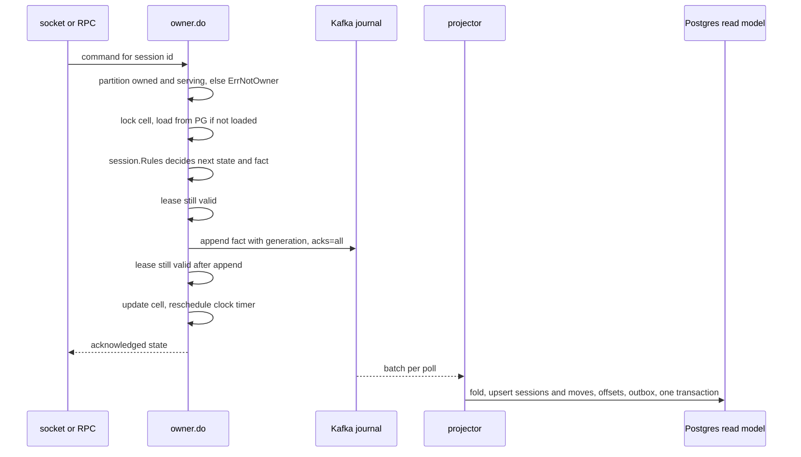

# owner

The owner is the single writer for live games. Each `game` instance owns a subset of the 24 journal partitions; for the sessions in those partitions it holds the current state in memory, decides commands with the pure rules in `session.Rules`, appends the resulting fact to the Kafka journal and only then acknowledges. Design records: [ADR 0001](../../../../../docs/adr/0001-event-sourced-game.md) and [ADR 0002](../../../../../docs/adr/0002-ownership-leases-fencing.md).

## Vocabulary

| Term | Meaning in code |
|---|---|
| partition | `journal.PartitionOf(session_id, 24)`, FNV-32a of the session id. The router, producer and projector compute it the same way. |
| part | One owned partition: `epoch`, `deadline`, `serving`, its cells and an `inflight` wait group. |
| cell | One session: a mutex, the state, the last `historyDepth` (4) moves for undo, the clock timer. |
| epoch / generation | `game.owners.generation` in Postgres, incremented by every claim. Not the Kafka group generation, which resets when an empty group is deleted. |
| lease | `game.owners.lease_until`, set from Postgres `clock_timestamp()`. TTL is `GAME_LEASE_TTL` (default 6 s), below the 10 s group session timeout. |
| claim marker | `JournalRecord.PartitionClaimed{generation, owner}` appended to the partition when it is claimed. |

## Invariants

1. **One writer per partition per generation.** Kafka group `game-owners` on `game.partition-leases.v1` decides who is assigned a partition; `Model.Claim` in Postgres decides the generation. A claim waits until the previous owner's lease has expired (`Lease.Wait`), so two owners never hold a valid lease at once.
2. **Acknowledge only after a durable append inside the lease.** `do()` checks the lease before the append, appends with `acks=all` and an idempotent producer, and checks the lease again after it. If the lease ran out during the append, the cell is marked unloaded, the partition is revoked and the caller gets `ErrNotOwner`. A zombie owner therefore never acknowledges after its local deadline.
3. **The local deadline is conservative.** `deadline = renewal start + TTL − min(1 s, TTL/4)`. Renewal runs every TTL/3 as one `UPDATE` for all held partitions, matched on `(partition, generation, owner_id)`. A renewal that returns without a partition means another owner took it (`lease_lost`); a renewal that fails past the deadline revokes everything (`lease_expiry`).
4. **Fencing.** Every event carries the owner's generation. The projector and a claiming owner drop events whose generation is below the last claim marker seen in that partition (`journal.Fence`).
5. **Catch up before serving.** A new owner reads the read-model offset, appends its claim marker, loads open sessions from Postgres, then folds the journal from the projected offset up to its own marker. Only then is `serving` set. Anything a previous owner acknowledged is therefore in memory before the first new command.
6. **Commands on one session are serialized** by the cell mutex. Commands on different sessions in one partition run concurrently.
7. **Revoke drains.** `revoke` stops serving, waits for `inflight` commands, releases the lease (so the successor does not wait the TTL), stops clock timers and tells open sockets to reconnect (`4001 moved`).

## Command path

A move is stored as a compact fact (`MoveApplied` with a `MoveOutcome`). Rare facts carry a full snapshot. On replay, `journal.Fold` re-derives the state with the same rules and fails with `ErrDiverged` if it does not match the recorded outcome.

## Claim path

`Assign` → `Model.Claim` (wait for the old lease) → append `PartitionClaimed` → `Model.Projected` → `Model.Open` → `Log.Read(projected, marker)` through a `Fence` → set `epoch`, `deadline`, `cells`, `serving` → schedule clock timers. The ownership loop retries claims every 2 s for partitions that are assigned but not serving.

## Known gaps on `main`

- An append error returns early without invalidating the cell. If the produce failed ambiguously (the broker persisted the record but the client saw a timeout or a cancelled context), the next command is decided from stale state. Fixing this is the scope of the `fix/game-owner-hardening` work.
- Cells are dropped only on revoke; finished games stay in memory until the partition moves.
- `Clock.StartedAt` is written by one host and evaluated against another host's clock after a handover.

## Tests

`owner_test.go`: `TestSimulatedHandoversNeverLoseAcceptedCommands` (20 seeds × 400 steps × 3 nodes, sequential revoke-then-assign handovers on the in-memory journal), `TestNewOwnerRecoversUnprojectedEventsAndFencesZombie`, `TestSuccessorWaitsForTheLeaseAndTheZombieStopsAcking`, `TestLostLeaseRevokesThePartition`, `TestRenewedLeaseKeepsServing`, `TestAppendFailureLeavesStateUnchanged` (clean failure only), `TestConcurrentUndoAndMoveSerialize`. Cluster behaviour under failure is in [docs/benchmarks.md](../../../../../docs/benchmarks.md#chaos-and-failover).
