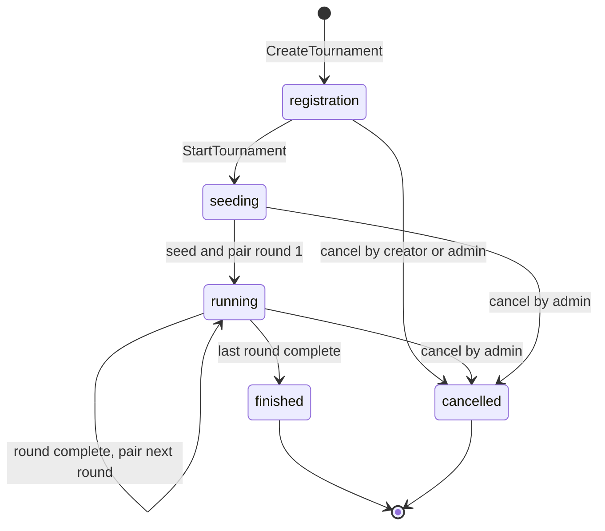

# tournament

A tournament is a long-running business transaction across many games. This service runs it as an orchestrated saga: all state lives in Postgres (schema `tournament`), commands to `game` and results from `game` travel as Kafka events through the transactional outbox, and every step is idempotent. Design record: [ADR 0004](../../../docs/adr/0004-tournament-saga.md).

## Packages

| Package | Role |
|---|---|
| `internal/saga` | Pure state machine. `Tournament` methods take the current state and `now` and return the next state plus effects. No I/O. |
| `internal/pairing` | Pure pairing: bracket seeding (1–8, 4–5, 2–7, 3–6), byes to the top seeds, Swiss pairing with backtracking to avoid rematches. Scores are integer half-points. |
| `internal/orchestrator` | Runs one saga step per transaction, turns effects into outbox events, owns the no-show sweeper. |
| `internal/store` | Postgres: loads the tournament `FOR UPDATE`, saves only the rows that changed, outbox, deadlines, `processed_events`. |
| `internal/consumer` | Consumer group `tournament` on `game.finished.v1` and `rating.changed.v1`. Commits offsets only after the step's transaction. |
| `internal/server` | `axon.tournament.v1.TournamentService`. Start and cancel are allowed to the creator or an `admin` (checked through `AuthService/GetMe` only when the caller is not the creator). |

## States

`StartTournament` commits `seeding` first. The next step, in its own transaction, seeds, pairs round 1 and publishes `round_started`. A crash between the two is recovered by the sweeper, which re-steps every tournament that is `seeding`, or `running` with no pending match in the current round (`store.Stalled`).

## Steps

Every step is `store.Update`: begin, `SELECT … FROM tournament.tournaments WHERE id = $1 FOR UPDATE`, run a pure function, write the changed rows and the outbox events, commit.

| Step | Trigger | Pure function | Effects written to `tournament.outbox` |
|---|---|---|---|
| seed | `StartTournament`, or the sweeper | `Tournament.Seed` | `tournament.round_started.v1`, plus one `tournament.deadlines` row per board |
| record | `game.finished.v1` with a `tournament_id` | `Tournament.Record` | none; marks the round finished when its last match is decided |
| advance | after `record`, or the sweeper | `Tournament.Advance` | next `round_started`, or `tournament.finished.v1` with standings |
| forfeit | sweeper, deadline due | `Tournament.Forfeit` | `tournament.forfeit.v1` |
| cancel | `CancelTournament` | `Tournament.Cancel` | `tournament.cancelled.v1` with returned players, or with the aborted sessions |

`game` reacts to the commands (consumer group `game-tournaments`): it creates the board sessions on `round_started`, makes the absent player resign on `forfeit` (only if that player has not moved yet), and on `cancelled` records the tournament in `game.cancelled_tournaments` and cancels the open sessions without emitting `game.finished`. Results reach the saga only through `game.finished.v1`. A win with fewer than 2 plies is recorded as a forfeit.

## Idempotency keys

| Key | Where | What it prevents |
|---|---|---|
| Tournament id = UUIDv5(creator, `request_id`), plus `UNIQUE (creator_id, request_id)` | `orchestrator.TournamentID`, migration `000001` | A retried `CreateTournament` creating a second tournament |
| Board session id = UUIDv5(tournament, round, board) | `core/shared/pkg/tournamentid` | A redelivered `round_started` creating a second game. `game` recomputes the id and rejects a mismatch. |
| Event id = UUIDv5(subject, kind, number) | `orchestrator.EventID`; outbox insert is `ON CONFLICT (id) DO NOTHING` | A re-run step publishing the same event twice |
| `processed_events.event_id` | `store.Tx.Claim`, same transaction as the result | A redelivered `game.finished.v1` being applied twice |
| Match already decided | `Tournament.Record` returns `changed=false` | The same result arriving under a new event id |
| `deadlines.session_id` primary key, `fired_at IS NULL … FOR UPDATE` re-read under the tournament lock | `store.Tx.Schedule`, `store.Tx.Deadline` | Two sweepers both firing one no-show deadline |

## Configuration

`TOURNAMENT_NO_SHOW_TIMEOUT` (default 2 min), `TOURNAMENT_SWEEP_INTERVAL` (default 1 s), `TOURNAMENT_OUTBOX_RETENTION` (default 24 h), `TOURNAMENT_CONSUMER_GROUP`, `TOURNAMENT_FINISHED_TOPIC`, `TOURNAMENT_RATING_TOPIC`.

## Tests

- Unit: `internal/saga`, `internal/pairing`, `internal/orchestrator`, `internal/consumer`, `internal/server`.
- Integration (`go test -tags integration ./integration/...`, testcontainers Postgres and Kafka): `TestBracketSagaSurvivesRedeliveryAndAnOrchestratorRestart`, `TestStalledStepsResumeAfterACrash`, `TestNoShowDeadlineForfeitsOnceAcrossInstances`, `TestCancellationCompensates`; game side in `core/services/game/integration/tournament_test.go`.
- E2E: `make test-e2e-tournament`, an eight-player bracket with a no-show through the gateway and CDC.

Results are in [docs/benchmarks.md](../../../docs/benchmarks.md#tournament-saga).

## Not covered

Swiss has unit and pairing tests only and was never run end to end. Admin cancel during play is covered by integration and server unit tests, not through the gateway. The web client polls every 2 s.
