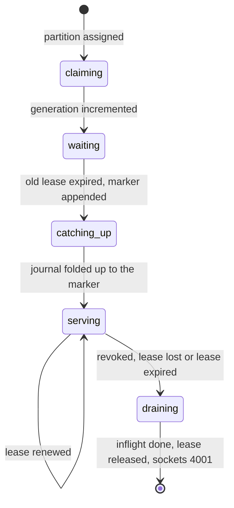

# 0002. Partition ownership with Postgres leases and generation fencing

- Status: accepted, 2026-11-20 (phase 1, lease added in phase 1b, lease pool in phase 3)
- Code: [`owner`](../../core/services/game/internal/owner/README.md), [`cluster`](../../core/services/game/internal/cluster/cluster.go), [`projection/postgres.go`](../../core/services/game/internal/projection/postgres.go) (`Claim`, `Renew`, `Release`)

## Context

[ADR 0001](0001-event-sourced-game.md) makes one `game` instance the only writer for a partition of the journal. Something has to decide who that is, hand partitions over when instances start, stop or crash, and stop a "zombie" that lost its partition without noticing from acknowledging moves. Phase 1 documented exactly that gap: a zombie could append until its Kafka session timed out, and its client saw a move that the new owner and the projector then dropped.

## Decision

- **Assignment** comes from Kafka: consumer group `game-owners` with the cooperative-sticky balancer on a dedicated topic `game.partition-leases.v1`, whose partitions mirror the journal's. Assigned means "should own".
- **Permission to write** comes from Postgres: `game.owners(partition, owner_id, address, generation, lease_until)`. `Claim` increments `generation` and returns how long to wait for the previous owner's `lease_until`, measured with Postgres `clock_timestamp()`. The claim waits that long before writing.
- **Fencing marker.** After the wait the owner appends `PartitionClaimed{generation, owner}` to the journal partition. Every event carries the generation it was written under. The projector and later owners drop events below the last marker (`journal.Fence`).
- **Catch-up before serving.** The new owner loads open sessions from the read model and folds the journal from the projected offset up to its own marker. Only then does it accept commands.
- **Lease with self-stop.** TTL 6 s (`GAME_LEASE_TTL`), below the 10 s group session timeout. Renewal every TTL/3 is one `UPDATE` matched on owner and generation. The owner does not acknowledge after its local deadline (renewal start + TTL − margin), checks the lease before and after every append, and revokes its partitions when renewal fails past that deadline. A clean revoke releases the lease at once so the successor does not wait.
- **Dedicated lease pool (phase 3).** `GAME_LEASE_DATABASE_URL` with 4 connections, so lease traffic never queues behind the projector.
- **Routing.** Non-owners forward RPCs and proxy WebSockets to the owner's address from `game.owners`, refreshed by `LISTEN game_owner_changed`. On handover sockets close with `4001 moved` and clients reconnect.

## Alternatives rejected

- Kafka group generation as the fencing epoch: it resets when an empty group is deleted, so it is not monotonic.
- Kafka assignment alone, without a lease: a partitioned instance keeps acknowledging until its session times out (the phase 1 known limitation).
- Lease renewal on the shared pool: flapped under +300 ms Postgres latency in phase 3 run 3 (12 `lease_expired` revocations).
- A StatefulSet with fixed partition ranges in Kubernetes: the game Deployment relies on the leases, so pods stay interchangeable.

## Consequences

- Two coordination planes. If Kafka assigns a partition but the claim fails, a reconcile loop retries every 2 s. If Postgres is unreachable longer than the lease span, every owner stops serving: Postgres is on the availability path.
- Failover is bounded by the group session timeout when an owner dies (about 11 s measured) and is sub-second for planned handovers (12 partitions in 0.3 s).
- The deadline is checked against the local monotonic clock, while `lease_until` is Postgres time; the margin, `min(1 s, TTL/4)`, absorbs the round trip.
- Gaps on `main`: an ambiguous append failure does not yet invalidate the cell, and cells are not evicted until the partition moves. See the [owner guide](../../core/services/game/internal/owner/README.md#known-gaps-on-main).
- `TestSimulatedHandoversNeverLoseAcceptedCommands` covers sequential handovers only (no concurrent commands, no crash inside an append). It is a model-based handover test, not deterministic simulation in the FoundationDB sense.

## Evidence

- Phase 1b decision and tests: [lease with self-stop](../../.claude/plans/platform-phase-1b-game-performance.md#решение); `TestSuccessorWaitsForTheLeaseAndTheZombieStopsAcking`, `TestLostLeaseRevokesThePartition`, `TestNewOwnerRecoversUnprojectedEventsAndFencesZombie`.
- Phase 3 runs 3 and 4, before and after the lease pool: [results](../../.claude/plans/platform-phase-3-scale-resilience.md#результаты-2026-11-20).
- Kubernetes: PDB and HPA with ownership moving between pods, 0 lost moves: [phase 6 results](../../.claude/plans/platform-phase-6-k8s-gitops.md#результаты-2026-11-20).
- Summary: [benchmarks](../benchmarks.md#chaos-and-failover).
