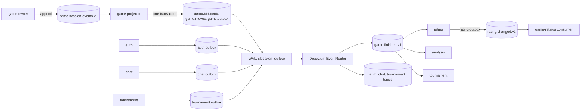

# 0003. Domain events through a transactional outbox and Debezium CDC

- Status: accepted, 2026-11-20 (phase 2)
- Code: [`core/shared/pkg/outbox`](../../core/shared/pkg/outbox), [`core/deploy/cdc`](../../core/deploy/cdc), [`projection/finished.go`](../../core/services/game/internal/projection/finished.go), [`core/services/rating`](../../core/services/rating)

## Context

Ratings were computed by the game projector in the same transaction as the read model, so they could not be recomputed, or their formula changed, without touching game. Chat and auth published no domain events at all. Publishing to Kafka directly from a handler is a dual write: the Postgres commit can succeed while the publish fails, or the other way round.

## Decision

- **Outbox per schema.** `outbox.Write(ctx, tx, "<schema>.outbox", events...)` inserts `(id, aggregatetype, aggregateid, type, payload)` in the caller's transaction, `ON CONFLICT (id) DO NOTHING`. The payload is protobuf from `axon/events/v1`. Tables: `auth`, `chat`, `game`, `rating`, `tournament`. A sweeper deletes rows older than 24 h; Debezium reads the WAL, not the table.
- **CDC.** Postgres runs with `wal_level=logical`. Job `cdc-setup` creates publication `axon_outbox` with `publish = 'insert'` (so cleanup deletes never become events) and the `debezium` role. One Debezium Postgres connector (`pgoutput`, slot `axon_outbox`) applies the Outbox Event Router: topic = `aggregatetype`, key = `aggregateid`, headers `event_id` and `event_type`, value passed through as bytes by `BinaryDataConverter`. A heartbeat through `pg_logical_emit_message` every 10 s keeps the slot advancing while no outbox is written.
- **Topics.** `auth.audit.v1`, `game.finished.v1`, `rating.changed.v1` and `tournament.finished.v1` are created by the connector with `retention.ms=-1`. Other outbox topics use broker defaults.
- **Consumers dedupe.** rating, analysis and tournament keep `processed_events` keyed by event id and write it in the same transaction as the effect. Offsets are committed after that transaction.
- **Schemas.** Apicurio holds `axon.events.v1`; compatibility is enforced by `buf breaking` against `main` in CI.

### Why `game.finished` goes through the read model

The projector detects the transition from "not finished" to "finished" while folding the journal and writes the `game.finished.v1` outbox row in the same transaction as the read-model row and the projector offset. The alternative, deriving the event straight from the journal, was rejected because:

- the event is atomic with read-model settlement: a consumer never sees a finished game the read model does not show;
- the journal is an internal format (compact facts, claim markers, replay through the game rules) that other services should not have to decode;
- the event id is UUIDv5 of the session id, so re-projecting the journal from any offset produces the same row and `ON CONFLICT DO NOTHING` drops it;
- the key is the game kind, so all games of one kind land in one partition in commit order, and a Glicko-2 rebuild from the topic replays them in the same order.

The cost is a longer path (journal → projector → Postgres → WAL → Debezium → Kafka) and another moving part on it.

## Alternatives rejected

- Publish from the handler after commit: the dual write this ADR exists to remove.
- A polling relay over the outbox table: needs its own ordering, locking and cleanup; logical replication already gives commit order.
- `ByteArrayConverter`: Debezium heartbeat records are `Struct` and break it.
- Shadow tables for `rating -rebuild`: the rebuild computes in memory with the same ledger code and compares with live tables.

## Consequences

- An inactive slot retains WAL; it is capped by `max_slot_wal_keep_size=1GB` in Compose.
- In Kubernetes the slot must survive a Postgres failover: CNPG synchronizes logical slots and the connector creates its slot with `slot.failover=true`. A second failover back onto the former primary is not covered.
- Apicurio runs in memory; after a registry restart the artifact is gone until `schema-register` runs again. Delivery does not depend on it.
- Games played before the switch are not in `game.finished.v1`; `rating -rebuild -apply` does not republish corrected ratings; `rebuild` refuses to run if the topic was truncated.
- `rating.changed.v1` is consumed back by game (`game-ratings`) to keep `game.ratings` for matchmaking, so ratings arrive 1.7–3.4 s after the last move.

## Evidence

- [Phase 2 results](../../.claude/plans/platform-phase-2-outbox-cdc.md#результаты-2026-11-20): Connect stopped 60 s under load, 50 of 50 games counted exactly once; `rating -rebuild` over 83 events equal to live state in 130 ms. Summary in [benchmarks](../benchmarks.md#outbox-cdc-and-rating-exactly-once).
- [Phase 6 results](../../.claude/plans/platform-phase-6-k8s-gitops.md#результаты-2026-11-20): connector stayed RUNNING through a CNPG primary failover.
- `make test-rating-e2e`; `core/shared/pkg/outbox/outbox_test.go`.
