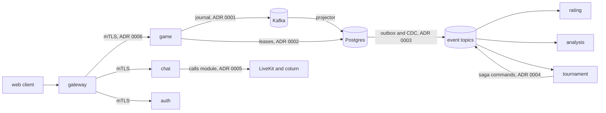

# Architecture decision records

One page per decision: context, decision, alternatives rejected, consequences including the costs, and links to the evidence. They are English summaries of the phase plans in `.claude/plans/`, which are in Russian and hold the full reasoning, deviations and raw results. Measured numbers are collected in [benchmarks](../benchmarks.md).

| # | Decision | Area |
|---|---|---|
| [0001](0001-event-sourced-game.md) | Live games on a Kafka journal, Postgres as the read model | game |
| [0002](0002-ownership-leases-fencing.md) | Partition ownership with Postgres leases and generation fencing | game |
| [0003](0003-outbox-cdc-debezium.md) | Domain events through a transactional outbox and Debezium CDC | platform |
| [0004](0004-tournament-saga.md) | Tournaments as an orchestrated saga over the outbox | tournament |
| [0005](0005-calls-inside-chat.md) | Calls as a module of the chat service | chat |
| [0006](0006-mtls-and-jwks-rotation.md) | mTLS between services and rotating JWT signing keys | security |
| [0007](0007-no-comments-in-code.md) | No comments in source code; the "why" lives in Markdown | conventions |

Package guides that go with them:

- [`core/services/game/internal/owner`](../../core/services/game/internal/owner/README.md): owner invariants and the command path.
- [`core/services/tournament`](../../core/services/tournament/README.md): saga states, steps and idempotency keys.
- [`core/deploy`](../../core/deploy/README.md): compose files, overlays and network zones.

## How the pieces fit

## Writing a new one

Copy the section layout of an existing ADR, number it next, and add a row above. Link every number to the plan section or test that produced it.
