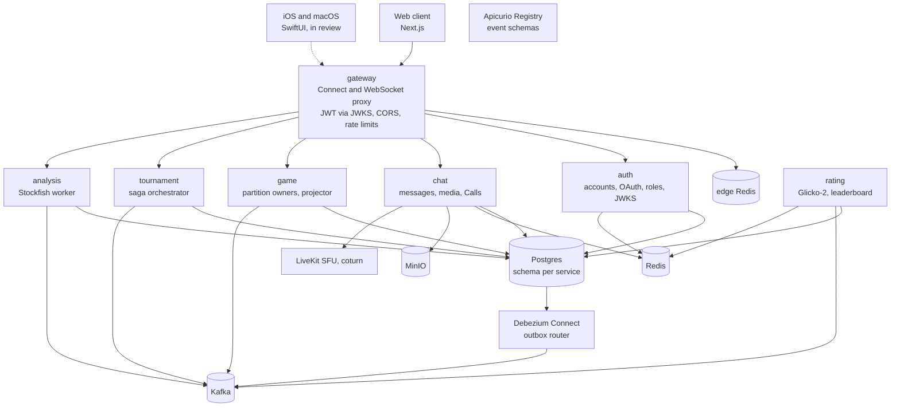
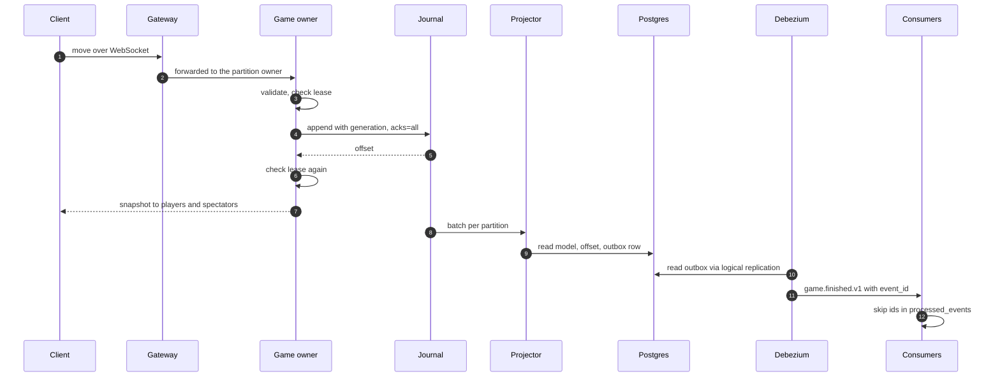
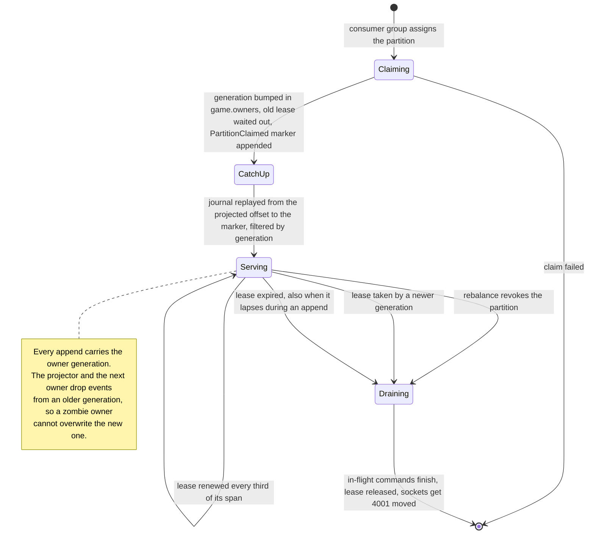
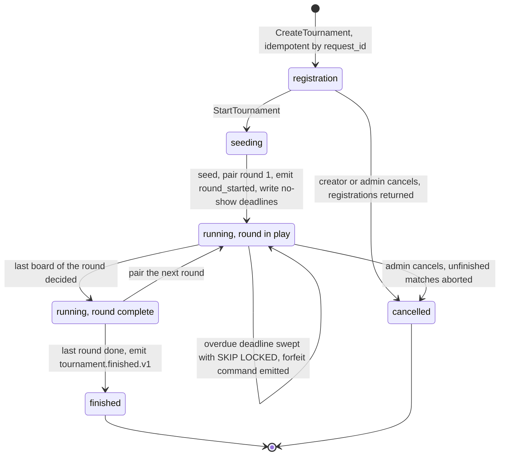
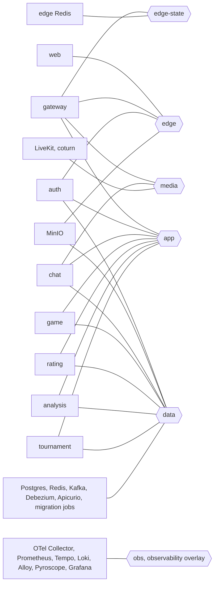
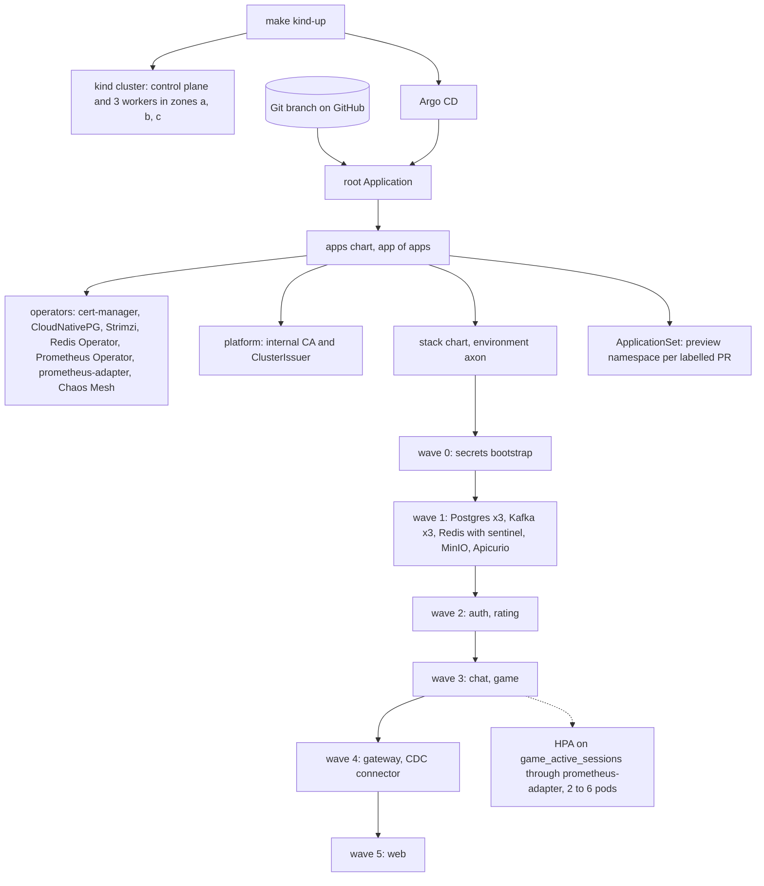

# Architecture

Axon is seven Go services behind one gateway. Game state is event-sourced on a
Kafka journal; every cross-service effect goes through a transactional outbox
and Debezium. Numbers quoted here come from the results sections of the phase
plans in [`.claude/plans/`](../.claude/plans/).

## Container view

Browsers send WebRTC media directly to each other, to coturn or to LiveKit,
never through the gateway. Debezium reads the outbox tables through logical
replication and publishes domain events to Kafka. The gateway is the trust boundary: it verifies JWTs locally against JWKS,
applies CORS and GCRA rate limits in its own Redis, and turns the refresh token
into an `httpOnly` cookie. Resource-level authorization stays in the service
that owns the resource. Services verify tokens themselves and, in the mTLS
overlay, accept only the client certificates on their allow-list.

## A move, end to end

The consumers are rating, analysis and tournament. The owner acknowledges a move
only after the journal append succeeds while its lease is valid, so an
acknowledged move is in the log. The projector writes the outbox row only for a
finished game. The projector upserts
with `WHERE revision < EXCLUDED.revision` and commits its Kafka offset in the
same Postgres transaction, so replays are harmless. `game.finished.v1` comes
from the outbox rather than the journal because it must be atomic with the read
model settlement. One trace ID covers `gateway.ws move → game.command →
journal.append → projector.apply`
([phase 4](../.claude/plans/platform-phase-4-observability.md)).

Load results: 803 → 1,524 moves/s against the old row-lock path, then p99
335 → 19 ms after compact events and a batched projector
([phase 1](../.claude/plans/platform-phase-1-game-event-sourcing.md),
[phase 1b](../.claude/plans/platform-phase-1b-game-performance.md)).

## Partition ownership

Sessions hash to the 24 partitions of `game.session-events.v1`. Kafka consumer
group assignment decides which replica should own a partition; a lease row in
`game.owners` decides whether it may write.

The fencing epoch is `game.owners.generation` in Postgres rather than the Kafka
group generation, which resets when an empty group is deleted. Lease renewals
run on a dedicated connection pool: on the shared pool, 300 ms of Postgres
latency made leases expire and ownership flap, which the phase 3 chaos run
caught and the dedicated pool fixed
([phase 3](../.claude/plans/platform-phase-3-scale-resilience.md)).

## Tournament saga

Each step is one transaction: the tournament row is locked `FOR UPDATE`, a pure
state machine computes the next state and its events, and state plus outbox rows
commit together. Event ids are UUIDv5 of tournament, round and board, and the
outbox insert is `ON CONFLICT DO NOTHING`, so a replayed step publishes nothing
twice. Game derives the same session id from the event and rejects mismatches.
Deadlines live in a table, not in memory timers
([phase 7c](../.claude/plans/platform-phase-7c-tournaments.md)).

## Network zones

The Compose project uses one network per responsibility, and each container
joins only the zones it needs. Stores are reachable only from their owners and
migration jobs; the gateway, web and media servers are not on `data`.

A `lan` zone carries DNS and checks for devices on the local network in the calls
overlays. Services join `obs` only in `docker-compose.observability.yml`.
Overlays and their combinations: [`core/deploy/README.md`](../core/deploy/README.md).

## Kubernetes and GitOps

Services share one library chart: Deployment, Service, PDB, HPA,
ServiceMonitor, a cert-manager `Certificate` for mTLS, PreSync migrations and
probes on the admin port. Game is a Deployment rather than a StatefulSet because
leases, not pod identity, decide ownership. Results: 19 applications
Synced/Healthy; HPA 2 → 3 under 150 parallel games and back to 2; a two-node
drain held by the PDB; the Chaos Mesh workflow with 4,000 games lost 0
acknowledged moves; CDC survived a Postgres failover
([phase 6](../.claude/plans/platform-phase-6-k8s-gitops.md)).

## Decisions

Full records: [docs/adr/README.md](adr/README.md). Benchmarks:
[docs/benchmarks.md](benchmarks.md). Compose overlays:
[core/deploy/README.md](../core/deploy/README.md).

- **Connect** — one contract served as gRPC, gRPC-Web and JSON, so the web
  client needs no proxy and `buf breaking` guards every client at once.
- **Schema per service** — each service owns a Postgres schema and login role
  with a pinned `search_path`, so services stay independently deployable on one
  database.
- **Kafka journal for game writes** — a move is accepted when the partition
  owner appends it, and Postgres is a projection; in Compose the journal keeps
  the broker's default retention, so the read model is the long-term record
  ([ADR 0001](adr/0001-event-sourced-game.md),
  [ADR 0002](adr/0002-ownership-leases-fencing.md)).
- **Redis is not a source of truth** — it holds rate limits, presence, fan-out
  and the leaderboard, all rebuildable, so losing it costs latency, not data.
- **Outbox and CDC** — events commit with the state change and Debezium
  publishes them, with deterministic ids and `processed_events` for
  exactly-once effects ([ADR 0003](adr/0003-outbox-cdc-debezium.md)).
- **Tournaments as a saga** — a long business transaction over game events with
  table-backed deadlines and idempotent steps
  ([ADR 0004](adr/0004-tournament-saga.md)).
- **Calls inside Chat (ADR-1)** — one deployable for messaging and call
  signaling, with `axon.calls.v1` as the extraction boundary
  ([ADR 0005](adr/0005-calls-inside-chat.md), [overview](calls.md)).
- **mTLS and JWKS rotation** — short-lived service certificates with
  allow-lists, and signing keys published before they sign, so rotation needs no
  downtime ([ADR 0006](adr/0006-mtls-and-jwks-rotation.md)).
- **No comments in code** — the why lives in plans, ADRs and commit messages
  ([ADR 0007](adr/0007-no-comments-in-code.md)).
