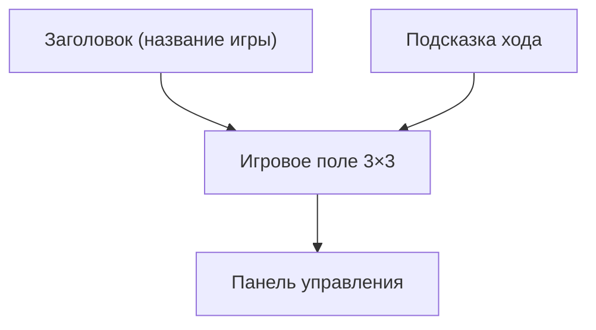

# Краткое содержание  
В отчёте приведены детальные рекомендации по визуальному дизайну игры «Крестики-нолики». Рассмотрены разные стилистические подходы (минимализм, ретро, неон, детский, material-дизайн и др.) с примерами ключевых отличий (см. таблицу 1). Описаны принципы компоновки экрана: заголовка, подсказок, центрального поля 3×3 (размеры, выравнивание, отступы). Даны настройки оформления сетки (толщина линий, скругления, разграничения), предложены несколько цветовых тем (светлая, тёмная, контрастная, «для дальтоников») с указанием HEX-цветов. Рассмотрены типографика (рекомендованные шрифты для заголовков и кнопок, размеры по иерархии) с ссылками на бесплатные варианты. Описаны состояния ячеек и анимации (пустая, hover/pressed, X/O, выигрышная подсветка). Даны рекомендации по размерам и микровзаимодействиям кнопок (Новая игра, Сброс, подсказка) и других элементов управления. Уделено внимание адаптации под мобильные экраны: адаптивная сетка, минимальные цели касания (tap targets) не менее 44×44pt, учёт «безопасных зон» (отступы от вырезов и крайних зон экрана). Рассмотрены аспекты доступности: контрастность ≥4.5:1 для основного текста, удобочитаемые размеры шрифта (рекомендовано ≥16pt для основного текста), семантические метки для экранных читалок. Приведены рекомендации по иконкам (интуитивные символы Х/О, кнопки «?» для подсказок и т.д.). Указаны стандартные размеры элементов в px/rem (например, поля 300–350px, отступы 16–24px). 

Дано пошаговое руководство: от выбора стиля (этапы формулировки задачи, референсов, создание moodboard) до финального макета. Приведён один подробный пример макета (см. рисунок ниже и таблицу 2): указаны конкретные размеры, отступы, цветовая палитра, шрифты (ссылки на бесплатные аналоги) и описаны состояния ячеек с анимациями (появление крестика/нолика, подсветка линии победы). Результаты оформлены в виде аналитического отчёта с таблицами для сравнения стилей и спецификаций макета.  

 *Рисунок: Пример макета экрана игры «Крестики-нолики» в стиле Material Design (светлая тема).*  

## Стили оформления интерфейса  
В зависимости от целевой аудитории и задумки игры выбирают стиль оформления:  
- **Минимализм:** лаконичные формы, минимум элементов, ограниченная палитра. Основной упор – простота: чистые линии, простые геометрические формы, обычно 2–3 цвета. Пример: белый или светло-серый фон, тонкие серые линии поля, контрастные символы X/О одного цвета (например, #212121).  
- **Ретро:** винтажная графика, пастельные или приглушённые яркие оттенки, старинные шрифты, декоративные орнаменты. Эффект «ностальгии» достигается текстурами (бумага, патина), модными шрифтами 70–80-х годов. Пример: фон с бумажной текстурой, линии поля коричневого или бежевого цвета, шрифты с засечками.  
- **Неон/киберпанк:** тёмный фон с яркими светящимися элементами (сеткой и крестиками/ноликами). Часто используются флуоресцентные цвета (синий, розовый, зелёный) на контрастном тёмном фоне. Градиенты и размытия создают эффект свечения.  
- **Детский:** яркие насыщенные цвета, крупные «дружелюбные» элементы, мультяшные шрифты. Цвета более пастельные или наоборот «сладкие» (розовый, светло-голубой, жёлтый). Удобочитаемые шрифты без засечек, крупнее (12–14pt минимум) и контрастные по отношению к фону. Иллюстративные иконки (например, вместо Х/О – цветные зверюшки). Активная обратная связь: подсвечивание, веселые звуки.  
- **Material Design (Google):** акцент на простом плоском оформлении с тенями. Фон светлый (#FFFFFF или #F5F5F5), карточки и поле белые, тени для глубины. Primary- и Secondary-цвета бренда для основных кнопок и элементов (пример: Primary #1976D2, Secondary #FFC107). Полупрозрачные тени  особенно в светлой теме. Интерфейс «воздушный», с активным использованием стандартных Material-компонентов (текстовые кнопки, карточки).  
- **Flat Design:** схож с Material, но без теней. Плоские яркие кнопки и элементы. Четкие контрастные цвета, акцент на типографике и пиктограммах, минимум декоративных элементов.  

Таблица 1. **Сравнение стилей** (характерные черты).  

| Стиль       | Цветовая гамма          | Формы и элементы       | Шрифты и иконки            | Пример настроения и применения                                            |
|:-----------:|:-----------------------:|:----------------------:|:--------------------------:|:-------------------------------------------------------------------------|
| Минимализм  | Нейтральные (белый, чёрный, серый); 1–2 акцентных цвета  | Прямые линии, много пустого пространства; без украшений | Чистые гротески (sans-serif); крупный контрастный размер       | Чистый, «скандинавский» стиль, для деловых или «лайфстайл» версий игры  |
| Ретро       | Пастельные или «выгоревшие» яркие (бежевые, коричневые, оливковые) | Закругления, текстуры (бумага, пыль), декоративные узоры | Винтажные шрифты с засечками; старомодные пиктограммы | Вызывает ностальгию; подходит для олдскульных или «классических» версий  |
| Неон        | Тёмный фон + светящиеся неоновые (кислотно-зелёный, розовый, синий) | Чистые геометрические формы; эффекты свечения (glow)   | Стильные крупные беззасечные; яркие контрастные   | Драматичный, футуристический образ; актуален в «киберпроекте» или для вечеринок |
| Детский     | Очень яркие, мультяшные (голубой, жёлтый, розовый)   | Крупные кнопки, мягкие формы; персонажи или картинки вместо стандартных иконок | Весёлые шрифты без засечек (Comic Sans, Rounded); крупный размер (≥14pt)  | Дружелюбный и игровой вид; важны простота и разборчивость для ребёнка  |
| Material    | Сбалансированный (Primary, Secondary + нейтральные)   | Чёткие прямоугольники; лёгкие тени; элементы-«карточки» | Стандартные Roboto/Roboto Medium; иконки Material Icons | Универсальный современный интерфейс; подходит под Android/iOS-гайдлайны  |
| Flat        | Смелые акцентные цвета, плоские (без теней)     | Геометрия без объёмных эффектов; прозрачность кнопок | Схож с Material; текстовые кнопки и иконки – без объёмов | Минимум визуального шума, фокус на UX; часто используется в веб- и мобильных UI |

## Компоновка экрана  
Элементами главного экрана обычно являются: заголовок (название игры или логотип) и подсказка хода, само игровое поле 3×3 и панель управления (кнопки “Новая игра”, “Сброс”, выбор уровня и т.д.). Общее правило — центрирование ключевых элементов на экране для фокусировки внимания. Расположение часто следующее:  

1. **Заголовок** – вверху, по центру (например, “Крестики-нолики”). Шрифт крупнее основного (например, 24–32pt) с высоким контрастом. Под заголовком может быть строка подсказки (“Ход: Х” или “Выиграл О!”). Минимальные отступы от верхнего края – 16–24px.  
2. **Игровое поле 3×3** – по центру экрана. Рекомендуемая ширина поля ~80–90% ширины экрана (чтобы было достаточно крупно, но вписывалось с боковыми отступами ~16px). Поле квадратное, каждая клетка одинакового размера (например, при ширине поля 300px – клетки по 100×100px). Поле центрируется горизонтально и вертикально с небольшим смещением вверх от центра (оставляя место для подсказки под ним).  
3. **Кнопки и элементы управления** – обычно внизу или снизу под полем. Например, ряд кнопок с равными промежутками (см. пример макета): “Новая игра”, “Сброс”, “Подсказка/уровень” и т.п. Размер каждой кнопки ≥ 44×44pt (практика Apple HIG) для удобства нажатия. Отступы между кнопками – 12–24px.  

Расстояния между компонентами (между заголовком и полем, полем и кнопками) делают достаточными (минимум 16–24px) для ясной иерархии. В мобильной версии важно учитывать **безопасные зоны** («safe area») – не размещать интерактивные элементы слишком близко к краю экрана (с учётом вырезов и системных панелей). Хорошая практика – оставлять поля ~10–20px у крайних границ.  

  

## Дизайн сетки 3×3  
Поле состоит из 9 ячеек. Есть два основных подхода:
- **Линии-разделители:** обычная сетка из двух вертикальных и двух горизонтальных линий. Рекомендации: толщина линий ~4–8px (чтобы хорошо просматривались на экране), цвет в контрасте с фоном поля. Например, для светлой темы линии тёмно-серые (#90A4AE) или Primary-цвета, для тёмной – светло-серые (#B0BEC5). Углы линий можно скруглить на 2–4px, чтобы смягчить вид.  
- **Карточки:** отдельные белые (или цветные) квадраты-«плитки» с зазором между ними (например, 8–12px). В этом случае самих разделяющих линий нет, а каждая клетка оформляется как элемент (card) с фоном и возможной тенью/рамкой. Это придаёт игровому полю «воздушность» (см. Material). Оба способа широко используются (в простом минималистичном UI обычно линии, в более «материальном» — карточки).  

Углы внешнего контура поля по желанию можно скруглить (например, радиус 8px). Если используется Material-тема, можно применить лёгкую тень к полю или карточкам (Elevation 2dp) – для визуальной глубины. Цвет фона поля (под клетками) обычно совпадает с фоном карточек: светлый (#FFF) или тёмный (#121212), чтобы не отвлекать.  

## Цветовые палитры  
Рекомендуется подготовить как минимум две темы: **светлую** и **тёмную**. Примеры палитр:  
- *Светлая:* фон приложения ≈#F5F5F5, поверхность карточек/поля – #FFFFFF, основные элементы (кнопки, активные X/О) – Primary или акцентный цвет (например, #1976D2), текст – тёмный (#212121). Тени чёткие.  
- *Тёмная:* фон ≈#121212 (темно-серый, а не чисто чёрный), поверхность поля ≈#1E1E1E. Primary-цвет приглушённее (например, #42A5F5 вместо #1976D2), текст светло-серый (#C4C4C4 для основного, #E1E1E1 – для заголовков). Тени заменяются светлыми наложениями.  
- **Контрастная:** для пользователей с нарушением зрения можно предусмотреть сильно контрастную тему (фон белый, линии/Текст – чёрный или ярко-цветной, X/О – красный/синий).  
- **Палитра для дальтоников:** важно избегать сочетаний зелёного/красного без текстовых меток. Можно, например, использовать синий для X и оранжевый для O. Убедитесь в контрасте: для основного текста стандарт WCAG ≥4.5:1 (для крупного текста ≥3:1), используйте проверку контраста при выборе цветов.  

В Material-дизайне каждый цвет имеет роли (primary, secondary, background, surface, error и их on-версии). Например, пример палитры: Primary #1976D2, Secondary #FFC107, Surface #FFFFFF, Background #F5F5F5, On-Primary #FFFFFF, On-Surface #212121. Эта система гарантирует читабельность на любом фоне.  

## Типографика  
**Иерархия шрифтов:** для заголовка экрана (название игры) – крупный вес и размер (не менее 24–32pt,  bold/medium). Подсказки (“Ход: X”) – обычный вес, чуть меньше (16–18pt). Кнопки – размер 14–16pt, средний вес. Для индикаций уровня/подсказок – ~12pt. Подписи («Выиграл X» и пр.) можно делать 16–18pt. Используйте не более 3–4 размеров для единообразия (см. таблицу размеров MD2).  

**Рекомендованные шрифты:** 
- Для основных текстов и кнопок – хорошо подходят нейтральные и читабельные гротески: [Roboto](https://fonts.google.com/specimen/Roboto) (широко поддерживается), [Noto Sans](https://fonts.google.com/specimen/Noto+Sans) (лучше для кириллицы), [Inter](https://fonts.google.com/specimen/Inter) или [Open Sans](https://fonts.google.com/specimen/Open+Sans).  
- Для заголовка или брендинга можно использовать более выразительные варианты (но бесплатные): например, [Montserrat](https://fonts.google.com/specimen/Montserrat) или [PT Sans/PT Serif](https://fonts.google.com/specimen/PT+Sans).  
- Детям рекомендуются округлые дружелюбные шрифты (например, [Comic Neue](https://fonts.google.com/specimen/Comic+Neue) или [Comfortaa](https://fonts.google.com/specimen/Comfortaa)) и крупный кегль (≥14pt) для понятности.  

Обеспечьте достаточный межстрочный интервал (line-height) для читаемости: не менее 1.2–1.4 от размера шрифта. Для интерфейсов обычно соблюдают соотношения: Body 16px, Headline 24–32px, Label/Button 14px. Например, основной текст (названия кнопок) – 14px (0.875rem) medium, заголовок – 24px (1.5rem) bold, подсказки 16px (1rem) regular. На iOS минимальный рекомендованный размер текста – 17pt (для Body).  

## Состояния ячеек и анимации  
Каждая клетка поля может находиться в состояниях: **пустая**, **при наведении/нажатии** (hover/pressed), **занятая X**, **занятая O**, **выигрышная подсветка**. Рекомендации:
- **Пустая:** фон клетки прозрачный или совпадает с цветом карточки; граница – тёмная линия/контур или отсутствует (в зависимости от стиля).  
- **Hover/Pressed:** при наведении мышью (или коротком тапе на мобильных) клетка слегка подсвечивается (например, меняется фон на #EEEEEE или Primary/100). При нажатии состояние «pressed» можно делать темнее (Primary/700) или менять тень (для карточки увеличить тень).  
- **Занятая (X/O):** при установке символа крестика или нолика в клетке, вместо пустой границы/фона появляется X или O крупным шрифтом/иконкой. Цвет символа – лучше контрастный (например, тёмный для светлой темы). Можно добавить небольшую анимацию появления (fade-in или масштабирование X/O). Например, при размещении X сделать легкое «нарастание» прозрачности или анимацию «всплеска» по размеру.  
- **Выигрышная линия:** когда игрок собрал линию из трёх, эти три клетки выделяют особым стилем: цвет символов меняется (например, становится ярким – зелёным/жёлтым) или клетки мигают/пульсируют. Можно обвести линию рамкой или светящейся линией. Анимация: плавная подсветка (fade) или пульсация «по кругу». Главное – явно показать победу.  

При любом действии (нажатии кнопки, установки символа) стоит давать момент обратной связи: краткая анимация (например, ripple-эффект по кнопке, либо быстрый эффект «всплеска» нажатия) или изменение цвета (в стиле material: при нажатии кнопки фон меняется на более тёмный оттенок Primary/700).  

## Кнопки и элементы управления  
Обычный набор: **Новая игра**, **Сброс** (новая партия), **Выбрать уровень/сложность**, **Подсказка**, **Меню/Информация**. Расположение: часто внизу экрана или в панели сверху.  
- Размеры кнопок – минимум 44×44pt (≈44×44px в мобильных дизайнах). Кнопки в шапке/подвале можно сделать больше (около 48×48pt) для уверенного нажатия.  
- Стиль кнопок – единый для всех. Например, Material-кнопка (закруглённый прямоугольник) с Primary-фоном и белым текстом. Или тонкая граница (outline) для вторичных действий (сброс). У кнопок крупный текст (14–16px) и крупная зона нажатия. Используйте явные и понятные иконки: кнопка «reset» – круговая стрелка, «настройки» – шестерёнка, «подсказка» – знак вопроса или лампочка. Метки кнопок (текст или tooltip) – ясные («Новая игра», «Сброс», «Подсказка»).  
- *Микровзаимодействия:* при нажатии – ripple/flash, при долгом удержании (если есть) – подсказка или контекстное меню. Например, долгое нажатие на кнопку «Подсказка» может показывать краткую инструкцию. При начале новой игры сбросить состояние поля (анимация очищения: X/O постепенно исчезают).  

Элементы управления (уровни, переключатели, иконки) соблюдают расстояние между собой ≥12pt (чтобы не промахнуться) и достаточную высоту области нажатия. Расстояния и размеры кнопок рекомендуются взять по стандартам Apple/Material: 16pt минимальный внутренний отступ, 44pt – размер цели. 

## Адаптация для мобильных устройств  
- **Адаптивная сетка:** гарантируйте, что поле 3×3 масштабируется под разные экраны. На маленьких телефонах (ширина ~320px) можно уменьшать поля с сохранением пропорций (например, поле 240px, клетка 80px). Главное – чтобы области нажатия ≥44pt. В портретной ориентации поле – квадрат; в ландшафтной можно центрировать его слева/справа, добавляя подсказки по краям.  
- **Touch targets:** см. выше (44pt). Избегайте слишком мелких шрифтов и кнопок. Интервалы между кнопками – не менее 8–12px, особенно если рядом иконки или переключатели.  
- **Safe area:** учтите вырезы (ноч), панели iOS/Android. Размещайте важные элементы внутрь «safe area» (например, заголовок немного ниже верхней планки, кнопки – выше нижней панели навигации).  
- **Жесты:** можно предусмотреть свайп вправо/влево для отмены хода или вызова меню. Но основные взаимодействия – простые (тапы), без сложных мультитач.  

## Доступность  
- **Контрастность:** используйте сочетания с WCAG 2.1 AA (текст – минимум 4.5:1, крупный текст – 3:1). Проверяйте контраст текстовых подписей и символов на фоне. В качестве on-составляющих (цвета текста на кнопках или на ярком фоне) берите белый (#FFFFFF) или очень тёмный. Избегайте чистого чёрного (#000000) в тёмной теме (лучше #121212 – менее утомительный).  
- **Размер текста:** минимум 12–14pt для всего текста интерфейса, заголовки 16–20pt+. Используйте автоувеличение шрифта (Dynamic Type на iOS). В Material под Android – sp единицы (текст масштабируется с настройками телефона).  
- **Этикетки для читалок:** у элементов UI задавайте понятные aria- или accessibility-имена. Например, X-клетка – «Клетка 1,1: крестик», кнопка подсказки – «Подсказка: кто ходит».  
- **Цветовые метки:** дополнительно к цветовым обозначениям (X vs O) можно сделать разную форму (X – крест, O – круг) или звуковой сигнал, чтобы дальтоник смог отличить фигуры по форме, а не только по цвету.  
- **Управление:** обеспечьте возможность продолжения игры голосом или крупными кнопками, если требуется (в рамках упрощения возможен интерфейс без голосовых команд).  

  

## Иконки и визуальные метафоры  
- **Иконки:** чёткие пиктограммы (иконка «X» и «O» можно изобразить в стиле шрифта icon, или использовать вектор SVG). Кнопка «Новая» – иконка «пауза->игра» или просто текст. Кнопка «Подсказка» – знак вопроса или лампочка. Иконки должны быть простые и знакомые.  
- **Эффекты:** при добавлении X/O можно сопровождать краткой анимацией (например, анимация появления или лёгкий bounce). Победа – анимация линий (blink или draw-line). Все анимации должны быть короткими (0.3–0.5 с) и опционально отключаемыми (важно для чувствительных пользователей).  
- **UI-компоненты:** для инструкций/подсказок можно использовать небольшие диалоги или тосты: всплывающие окна с текстом «Нажмите на ячейку, чтобы поставить крестик» и т.п. Их стиль должен соответствовать общей теме (Material Card или простое модальное окно).  

## Размеры в px/rem и таблица спецификации  
Ниже приведён пример конкретных числовых спецификаций для светлой Material-темы (табл. 2). Отступы адаптируются пропорционально экрану (значения в rem и px для базовой ширины 360px).  

  

Таблица 2. **Спецификация макета (пример)**. Первая колонка – элемент интерфейса; далее – рекомендуемые размеры и отступы (в px для экрана ~360px ширины), цвета (HEX) и шрифты (size и weight).  

| Элемент          | Размер/отступ (px)             | Цвета (HEX)                 | Шрифт (размер, стиль)                    | Комментарии                                |
|:----------------:|:------------------------------:|:---------------------------:|:----------------------------------------:|:------------------------------------------:|
| Фон экрана       | –                              | #F5F5F5 (фон)       | –                                        | Цвет фона приложения (светлая тема)        |
| Заголовок игры   | font-size 24 (24px = 1.5rem)   | #212121 (тёмный)            | Roboto, Bold                             | Отступ сверху 24px, центр                 |
| Подсказка        | font-size 16                   | #757575                      | Roboto, Regular                         | Текст «Ход: Х», под заголовком            |
| Поле 3×3         | Ширина 300, высота 300 (3×100px) | #FFFFFF (фон поля) | –                                        | Центр экрана; отступы от краёв по 30px    |
| Линии сетки      | толщ. 6px                      | #90A4AE (светло-серый)       | –                                        | Между клетками; скругл. концов 3px        |
| Ячейка пустая    | 100×100                        | (фон поля)                   | –                                        | Пустое состояние                        |
| Ячейка X/O       | 100×100                        | –                            | Roboto Slab 60pt (X/O), Black            | Появление X/O (пример: X 60px);            |
| Победная линия   | толщ. 6px                      | #FFEB3B (жёлтый акцент)      | –                                        | Линия через 3 клетки, подсветка           |
| Кнопка «Новая»   | 90×35                          | #1976D2 (Primary) | Roboto, Medium 14pt, цвет текста #FFF     | Расположение внизу; маргин 20px сверху    |
| Кнопка «Сброс»   | 90×35                          | #FFFFFF (контур) / #1976D2 (текст) | Roboto, Medium 14pt, цвет текста #1976D2 | Обводка (1px #1976D2), отступ слева 20px |
| Кнопка «Подсказка» | 40×40 (иконка)              | #FF5722 (оранжевый)          | – (иконка лампочки)                     | Справа от «Сброс», отступ слева 12px      |

*Примечания:* размеры даны как пример для макета. В мобильной вёрстке 1rem≈16px, учтите масштабирование. Цвета Primary/Secondary и их оттенки подбираются по системе Material (см. [30]) или по вкусу. Шрифты – ссылки на Google Fonts приведены выше.  

## Mermaid-диаграмма компоновки  

Данная диаграмма иллюстрирует иерархию элементов: заголовок и подсказка располагаются над центральным полем, под полем – кнопки управления.

**Источники:** материалы руководств Apple HIG и Material Design (разделы «цвет», «типография», «доступность»), статьи по дизайну UX/UI (в т.ч. по дизайну для детей), а также общий опыт UI-дизайна и приведённые примеры в сети (например, [72], [30]).  Все использованные рекомендации основаны на проверенных дизайнерах и официальных гайдлайнах, приведённых в источниках.