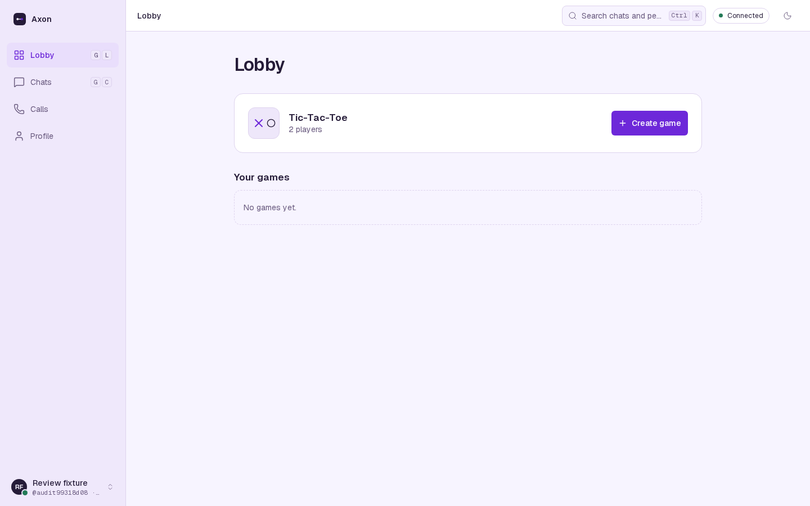

# Axon — приложения к ревью 14–15 ноября 2026

[Назад к сводке](../2026-11-14-project-review.md)

## 1. Общая оценка

Axon уже работает как платформа общения с авторизацией, личными и групповыми чатами, вложениями, звонками и одной игрой. Самая развитая часть — chat/auth. Calls имеет существенную реализацию состояния, сигналинга, восстановления и медиатранспорта, но требует наиболее дорогой проверки на реальных устройствах. Игровая часть пока подтверждает подход на Tic-Tac-Toe.

До исправлений найден существенный дефект конфиденциальности: вложение можно было скачать прямо из публичного MinIO bucket без сессии и проверки участия в чате. Также отсутствовала защита исходящих HTTP-запросов от обращений во внутреннюю сеть, внутренние порты публиковались на всех интерфейсах, а используемый Go имел известный advisory. Эти места изменены.

На уровне интерфейса проблема была не только в цвете. Мобильная и настольная навигация имели разный порядок и состав разделов, а планшет получал ещё один вариант оболочки. Теперь у сайта один набор разделов, одна палитра и согласованные состояния; ширина экрана меняет расположение элементов.

**Для портфолио проект имеет содержательную реализацию. Для публичного запуска остаются эксплуатационные критерии.**

## 2. Что фактически реализовано

| Часть | Фактическое состояние | Вывод |
|---|---|---|
| Gateway | Connect/RPC proxy, проверка JWT, политики методов, CORS, лимитеры, WebSocket и upload proxy | Настоящая граница входа; внутренние сервисы нельзя публиковать в обход неё |
| Auth | Пароли, refresh rotation, семейства сессий, JWKS/RS256, профиль, username, роли, OAuth adapters, аватары | Зрелее остальных модулей; реальная работа внешних провайдеров отдельно не подтверждена |
| Chat | Личные/групповые комнаты, membership, история, поиск, редактирование/удаление, пересылка, прочтение, presence | Рабочая основа продукта, есть несколько уровней тестов |
| Media | Multipart, возобновление, дедупликация, обработка фото/видео, Brotli, альбомы, уборка черновиков | Функционально развито; доступ к скачиванию теперь проверяется сервером |
| Calls | Модуль внутри Chat, native WebRTC/coturn, SFU и миграции транспорта в имеющейся ветке | Отсутствие отдельного сервиса `calling` соответствует ADR, это не пропуск реализации |
| Game | Общий интерфейс движка, registry, состояние в Postgres, RPC/WS, Tic-Tac-Toe | Наличие общего интерфейса ещё не означает готовность пяти игр |
| Chess / Checkers / Durak / Quoridor | Реализаций в проверенном дереве нет | Это незавершённый продуктовый объём, а не исправленный в этом аудите баг |
| Web | Next.js, Connect, TanStack Query, компоненты чата/звонков/профиля/игры | Основной рабочий клиент |
| SwiftUI | Каталога с реализованным клиентом `ui/app` нет | Проверить или унифицировать работающий native UI сейчас невозможно |
| Инфраструктура | Compose, Postgres, Redis, Kafka, MinIO, HTTPS LAN, coturn, LiveKit | Хороший локальный стенд; свойства production не следуют из его наличия |

Схема из вводной документации описывает и желаемое будущее состояние. В частности, перечисление пяти игр и SwiftUI нельзя использовать как перечень готовых функций. Рекомендуется разделять implemented/planned в README и roadmap.

## 3. Приоритеты и основания

Приоритеты проекта учитывают подтверждённость и последствия. P1 — прямая угроза приватным данным или подтверждённая по коду достижимая граница с существенными последствиями. P2 — значимый дефект или профилактика по advisory. P3 — качество, доступность отдельных элементов интерфейса и предпочтения оформления.

| ID | Приоритет | Статус | Основание |
|---|---|---|---|
| SEC-01 | P1 | Исправлено | Воспроизведено на стенде. Неавторизованный GET вложения возвращал 200. |
| SEC-02 | P1 | Исправлено | По коду endpoint от авторизованного пользователя попадал в сетевой клиент без ограничения назначения. Внешняя доставка на стенде не подтверждена. P1 за достижимую границу сервера. |
| SEC-03 | P2 | Исправлено | Воспроизведено с fake OAuth. В реальном потоке URL зависит от ответа провайдера. |
| SEC-04 | P2 | Обновлено | Advisory обнаружен сканером. Падение Go 1.27.3 не воспроизводилось. |
| SEC-05 | P2 | Исправлено | Публикация внутренних портов на всех интерфейсах подтверждена конфигурацией стенда. Внешний обход gateway не проверялся. |
| SEC-06 | P2 | Исправлено | Воспроизведено. Чужой Origin с действующим JWT получал 200. |
| SEC-07 | P2 | Исправлено | В ответе веб-стенда отсутствовали защитные заголовки. Последствия оценены по конфигурации. |
| REL-01 | P3 | Исправлено | По коду отсутствовал запуск очистки upload limiter. Рост памяти или деградация не измерялись. |
| REL-02 | P2 | Исправлено | Воспроизведено в Chromium. После повторного входа ложный диалог звонка блокировал чат. |
| UI-01 | P2 | Исправлено | Состав и порядок навигации расходились на реальных проверенных размерах экрана. |
| UI-02 | P3 | Сделано | Визуальный выбор владельца. Светлая сирень и насыщенный фиолетовый. |
| UI-03 | P3 | Исправлено | По старому компоненту подтверждён неполный контракт radio. Клавиатура после исправления проверена в Chromium. |
| UI-04 | P2 | Исправлено | LAN URL аватара указывал на localhost клиента. На HTTPS-стенде после исправления проверены загрузка и отображение. |
| CI-01 | P2 | Исправлено в конфигурации | Game отсутствовал в matrix по YAML. Удалённый workflow не запускался. |
| DEP-01 | P2 | Обновлено | Findings сканера по cel-go и x/crypto, вызова уязвимых функций в Axon не найдено. |
| QLT-01 | P3 | Исправлено | Ошибки подтверждены Go lint. После исправления невалидная WS-команда даёт штатную ошибку. |

## 4. SEC-01: приватные вложения были публичными

### Подтверждение

На собственном тестовом аккаунте загружен небольшой файл-маркер. До изменений GET его MinIO URL без авторизации возвращал **200**. В compose init использовалось `mc anonymous set download` для `chat-attachments`. Знание URL было достаточным условием доступа; membership чата не проверялся.

Это не подбор UUID и не обход JWT. Это отдельный публичный маршрут, на котором JWT и ACL вообще отсутствовали. Ссылку мог получить пересланный лог, история браузера, получатель сообщения или другое место, где сохранился URL.

### Исправление

- Bucket `chat-attachments` стал private во всех соответствующих compose-конфигурациях. Chat дополнительно снимает публичную policy при старте, поэтому исправление применяется и к существующему bucket.
- Gateway предоставляет `GET/HEAD /api/media/{key}` и передаёт проверенный bearer в Chat. Тот же адрес публикуется через LAN ingress, а старый путь `/api/api/media/{key}` перенаправляется на него.
- Для ``, `<video>` и скачивания браузер получает короткоживущую HttpOnly-cookie `axon_media`. Она содержит access token, имеет срок access token, `Path=/api/media`, SameSite=Lax и Secure на HTTPS-стенде. Logout очищает cookie. Широкая cookie прежней версии удаляется при выдаче новой и на logout.
- Chat повторно проверяет JWT, наличие family ID и активность семейства сессии. Старый access token от вышедшей сессии не позволяет продолжать скачивание.
- `CanReadObject` связывает объект с upload/file и с доступными пользователю сообщениями. Одного знания object key недостаточно.
- Для отправленного файла нужен текущий membership и неудалённое сообщение после `cleared_through_seq`. Собственный ещё не отправленный upload доступен владельцу как черновик.
- Учитываются одиночные вложения, `message_uploads` альбомов, дедуплицированные files и прежние URL в payload.
- Скачивание поддерживает `HEAD` и `Range`; ответы помечаются `private, no-store`, `nosniff`, CSP sandbox.
- Web преобразует старые attachment URL в защищённый маршрут. Миграция 17 добавляет GIN-индекс `files.object_keys`.

Код: [media ACL](../../../../core/services/chat/internal/repository/media.go), [download handler](../../../../core/services/chat/internal/server/media.go), [gateway proxy](../../../../core/services/gateway/internal/mediaproxy/proxy.go), [web URL mapping](../../../../ui/web/src/lib/chat/media-url.ts), [миграция 17](../../../../core/services/chat/migrations/000017_private_media.up.sql).

### Проверка после исправления

| Действие | Результат |
|---|---|
| Прямой GET в private bucket | 403 |
| GET через gateway без авторизации | 401 |
| GET чужого черновика авторизованным пользователем | 404 |
| GET владельца с media-cookie | 200, содержимое совпадает |
| Range `0–6` для тестового файла | 206, правильные байты |
| GET со старым access token после Logout | 401 |
| Membership появился после отправки | Доступ есть |
| История очищена / membership удалён / сообщение удалено | Доступ закрыт в integration-тесте |
| Фото и видео в браузере у участников | Открываются; видео воспроизводится |

Проверка активной family добавляет обращение к Auth и зависимость загрузки от его доступности. При сбое доступ закрыт. Остаточные риски описаны в разделе «Границы проверки».

## 5. SEC-02 / SEC-03: исходящие запросы и SSRF

### Причина

Проверка push subscription ограничивалась формой строки с `https://`. HTTPS не гарантирует публичный адрес: host может быть loopback, private IP или именем, которое DNS разрешит во внутреннюю сеть. Обычный HTTP client может также следовать redirect.

Avatar pipeline скачивал URL, полученный от OAuth-провайдера, обычным клиентом. В production источник ограничен ответом провайдера, поэтому это не доказанный произвольный ввод любого анонимного пользователя. Однако граница исходящей сети отсутствовала; fake provider на тестовом стенде позволял воспроизвести импорт внутреннего URL.

### Что теперь проверяется

Общий [safehttp](../../../../core/shared/pkg/safehttp/client.go) используется для push, call notifications и загрузки OAuth-аватара:

1. Только HTTPS на стандартном порту 443; без userinfo, fragment и opaque URL.
2. Запрет localhost, одночастных внутренних имён и заведомо непубличных IP.
3. Проверка всех полученных DNS-адресов; смешанный public/private DNS-ответ тоже отклоняется.
4. Соединение открывается с уже проверенным IP, без повторного разрешения имени в dial. Это закрывает смену адреса между проверкой и подключением.
5. Не используются proxy из окружения; redirect не выполняется.
6. Ограничены общий таймаут, TLS handshake, ожидание заголовков и idle connections.
7. IPv4-mapped IPv6 нормализуется; исключены private/link-local, специальные и документальные диапазоны, включая NAT64 и site-local.

Unit-тесты подтверждают, что unsafe URL отклоняется, private/mixed DNS не вызывает dial, а публичный адрес передаётся в dial в проверенном виде. 

У avatar integration-теста локальный HTTP client передаётся явно для тестового HTTP-сервера. Production-конструктор с `nil` использует защищённый клиент. Core E2E теперь проверяет отказ от импорта аватара из private MinIO, сохраняя успешный OAuth-вход. Отдельно проверены штатная загрузка своего аватара, HTTPS URL и видимое изображение на мобильном экране.

## 6. Зависимости и известные уязвимости

### Go runtime

Исходный `govulncheck` сообщил **GO-2026-6859**: race в HTTP/1 MaxBytesReader с возможностью падения server. В отчёте сканера указан диапазон `go1.27.3 → go1.27.4`. Обновлены `go.work`, пять `go.mod`, Dockerfile и Go-образы test/tools. Все четыре сервисных бинарника пересобраны.

Первичное доказательство — [лог сканера до исправления](evidence/govulncheck-before.log). [Страница advisory](https://pkg.go.dev/vuln/GO-2026-6859) не открылась через браузерный инструмент; описание и версия исправления здесь приведены по полученному CLI-отчёту. Падение сервера специальной нагрузкой не воспроизводилось.

### Транзитивные библиотеки

- **GO-2026-6094** затрагивал `github.com/google/cel-go/ext` в 0.29.0: доступ к JSON-private полям через NativeTypes/ParseStructTag. В бинарнике Chat были затронутые пакеты, но сканер не нашёл уязвимых вызываемых symbols. Библиотека всё равно обновлена до **0.30.0**. [Go advisory](https://pkg.go.dev/vuln/GO-2026-6094).
- **GO-2026-5932** касается неподдерживаемого `golang.org/x/crypto/openpgp`. До обновления находился advisory на уровне требуемого модуля, без вызова уязвимого кода Axon. Обновление x/crypto до **0.59.0** убирает старую версию из выбранного графа. Это не рекомендация использовать OpenPGP из этого пакета. [Go advisory](https://pkg.go.dev/vuln/GO-2026-5932).
- Обновление x/crypto также подняло совместимые `x/sys`, `x/text`, `x/sync`, `x/mod` в соответствующем графе зависимостей.
- `npm audit --omit=dev` вернул **0 известных уязвимостей** в production-зависимостях на момент проверки.

Заключительное сканирование четырёх пересобранных бинарников Auth, Chat, Gateway и Game завершилось **No vulnerabilities found**, включая package/module-level findings.

Source analysis Chat дважды завершился `signal: killed` в ограниченном Docker-окружении. Вместо объявления такого запуска успешным выполнен binary scan. Это различие сохранено в логах; в CI добавлен source `govulncheck` для всех пяти модулей.

## 7. Gateway, cookies и инфраструктура

### Внутренние порты

До изменения published ports Postgres, Redis, MinIO, Kafka, Auth/Chat и metrics были доступны через `0.0.0.0`. На машине в LAN это расширяет границу доступа и может позволить обращаться к сервисам в обход gateway. Наличие пароля на БД не делает публикацию необходимой.

В основном compose публикации переведены на `127.0.0.1`. Межконтейнерные имена и сеть работают как прежде. Отдельно предназначенные для LAN HTTPS ingress, TURN и LiveKit не закрывались: иначе перестали бы работать телефон и звонки.

### Origin

До изменения GetMe с валидным JWT и чужим Origin возвращал 200 без разрешающих CORS headers. Браузер мог запретить JavaScript прочитать ответ, но операция на сервере всё равно выполнялась. Теперь неизвестный непустой Origin получает 403 до downstream handler. Запросы native/server клиентов без Origin продолжают работать.

### Лимитеры

Для upload-parts limiter отсутствовал вызов `Start(ctx)`: записи могли оставаться без штатной очистки. Lifecycle запущен. При этом лимитеры по-прежнему локальны процессу; несколько gateway-реплик не образуют единую распределённую квоту.

Во время серии E2E регистрация получила 429. Это ожидаемая работа ограничения, а не причина повышать лимит в приложении. Для security fixture добавлен ограниченный повтор только на 429. Неожиданный 400/401/500 не скрывается таким повтором.

### Web headers

На живом `/login` проверены:

```text
X-Content-Type-Options: nosniff
X-Frame-Options: DENY
Referrer-Policy: strict-origin-when-cross-origin
Content-Security-Policy: frame-ancestors 'none'; object-src 'none'; base-uri 'self'
Permissions-Policy: camera=(self), microphone=(self), display-capture=(self), geolocation=()
```

CSP ограничивает framing, objects и base URI.

## 8. Auth: оценка реализации

Положительные стороны: локальная проверка RS256/JWKS; выделенные семейства refresh token; ротация refresh в транзакции; обработка повторного использования; Argon2 и dummy-проверка для неизвестного пользователя; отделение публичного профиля от внутренних данных; авторизация административных методов.

Проверено через реальные API: отсутствие и повреждение JWT дают 401; обычный пользователь не может назначить себе роль; login/logout/refresh/profile/username/OAuth fake входят в серверные E2E. После изменения media-cookie дополнительно проверены HttpOnly/Secure/host-only/SameSite/TTL и удаление cookie при logout.

Ограничения:

- Проверка JWT по подписи не равна мгновенному отзыву всех access tokens. У обычных RPC остаётся окно жизни access token; Calls и новый media route дополнительно проверяют family. Это нужно учитывать при обещаниях пользователю «завершить сессию везде».
- Жизненный цикл аккаунта нужно оценивать отдельно: подтверждение email, восстановление доступа, удаление аккаунта и требования хранения данных не считаются готовыми только потому, что существует поле `email_verified`.
- Публичность аватаров сохранена как публичная часть профиля; приватность attachment bucket не переносится автоматически на avatars.

## 9. Chat и медиа: оценка реализации

У чата есть явная модель membership и ролей, последовательность сообщений, граница очищенной истории, отдельные upload/file сущности и пути обработки альбомов. Это позволяет проверять доступ на уровне ресурса, а не доверять одному gateway.

В положительных и негативных тестах проверены группы, поиск и чужое членство, пересылка, удаление, unread/read, typing, presence, загрузки и дедуп. Используются настоящие Postgres/Redis/MinIO в integration/E2E. Для фото/видео в заключительном браузерном прогоне подтверждены загрузка, открытие и воспроизведение.

Сильные стороны media pipeline: ограничение размера, обработка с контекстом/таймаутом, ограничение ffmpeg threads и protocol whitelist, удаление метаданных фото, multipart/resume, уборка черновиков. Проверка с реальным ffmpeg выполнена внутри Docker.

Что остаётся риском:

- Ограничение одного файла не ограничивает общий объём файлов пользователя. Не доказана достаточная защита от накопления большого количества разрешённых загрузок.
- Нет подтверждённого эксплуатационного бюджета CPU/диска/очереди на transcoding и downloads. Без него один корректный тяжёлый сценарий может конкурировать с обычным чатом.
- Объекты и сообщения требуют согласованной backup/restore-процедуры. Успешные CRUD-тесты не проверяют восстановление после потери диска.
- Новый SQL ACL проверяет и современные file keys, и legacy payload. Legacy-путь потенциально дороже; нужны реальные EXPLAIN/нагрузочные замеры на объёме production перед масштабированием.

## 10. Calls: оценка и найденная гонка

Calls правильно остаётся модулем Chat в соответствии с ADR. В коде есть endpoint identity, привязка к session family, outbox/ack/resync, состояния звонка, cleanup и разные транспортные пути. Разделение store/signaling/media полезно для возможного будущего выделения сервиса.

### Ошибка повторного входа

На живом тесте: пользователь отправлял сообщение, выходил, открывал закрытый чат и входил снова. История успешно загружалась, но поверх неё появлялся диалог `Could not start the call / Call connection is unavailable`. Из-за модального диалога содержимое чата становилось недоступно для взаимодействия.

Причина в CallChannel: `initialize()` восстанавливал сохранённый endpoint и обрабатывал его отказ после отзыва старой family, а параллельный WebSocket `open()` начинал ещё один resume. Второй путь сообщал ошибку раньше восстановления нового endpoint.

Теперь `open()` ждёт текущую initialization promise. Добавлен unit на stale endpoint + одновременное открытие socket; повторный вход в реальном браузере после исправления проходит.

Код: [CallChannel](../../../../ui/web/src/lib/calls/channel.ts), [регрессия гонки](../../../../ui/web/src/lib/calls/channel.test.ts), [существующий login/chat E2E](../../../../ui/web/e2e/chat.spec.ts).

### Что подтверждено текущим live-прогоном

Созданы два тестовых пользователя, открыт личный чат, получено входящее приглашение на мобильном viewport, принят звонок. Проверено увеличение входящих audio packets и audio energy у обоих участников; после End локальные/удалённые tracks перешли в `ended`. Проверены экран результата и отсутствие перекрытия входящего звонка старым message toast.

Использовался Chromium с WebRTC и тестовыми микрофонами.

## 11. Game: оценка реализации

Реализован общий интерфейс Game и один зарегистрированный движок Tic-Tac-Toe. Состояние и участники сохраняются в Postgres; изменения используют транзакцию/блокировку строки. Проверки номера хода, очереди игрока и завершённого состояния уменьшают риск повторного и устаревшего хода. WS доставляет обновления, а Postgres остаётся источником истины.

В браузере проверяется цепочка: создание → приглашение второго игрока → партия до победы → reload → новая партия до ничьей; третий пользователь не может присоединиться. Негативный API-тест также проверяет недоступность чужой сессии.

У `game/internal/server` и `game/internal/session` отсутствовали собственные test-файлы: покрытие через E2E не заменяет изолированные concurrency/rollback-тесты. Это особенно важно перед добавлением более сложных правил и нескольких реплик.

Статическая проверка дополнительно обнаружила игнорирование ошибок cleanup и неявное превращение ошибки JSON decoding в успешный read. Cleanup теперь явно best-effort, malformed WS command имеет отдельную ошибку и приводит к штатному `INVALID_COMMAND`, сохраняя лимитирование сообщений.

Четыре остальные игры не создавались в рамках исправления аудита. Реализацию Quoridor нельзя считать существующей по одному описанию BFS в AGENTS/roadmap.

## 12. Новый единый дизайн сайта

Выбранное владельцем направление: **светлая сирень и насыщенный фиолетовый, выразительный**. Сохранены назначения экранов, пользовательские данные, функции чата и звонков. Изменены визуальная система и поведение оболочки на разных ширинах.

### Основные токены

| Роль | Светлая тема | Тёмная тема |
|---|---|---|
| Фон | `#f7f4ff` | `#171122` |
| Основной текст | `#251b38` | `#f2ecff` |
| Карточка | `#ffffff` | `#21182f` |
| Основной акцент | `#6d28d9` | `#bf9bff` |
| Текст на акценте | `#ffffff` | `#27123f` |
| Вторичная поверхность | `#eee7fa` | `#322542` |
| Вторичный текст | `#6b5c80` | `#b9a9cf` |
| Граница | `#ded3ee` | `#49375e` |
| Sidebar / tabbar | `#efe8fb` | `#1c1428` |

Успех, предупреждение и ошибка имеют отдельные семантические цвета. Фиолетовый не используется вместо смысла статусов. Базовый текст увеличен до 15/22 px, малый — до 14/20 px.

### Навигация и адаптивность

- На всех ширинах разделы одинаковы: **Lobby → Chats → Calls → Profile**. Они берутся из одного `nav/items.ts`.
- Desktop от 1024 px: sidebar 224 px с текстом, иконками и аккаунтом.
- Tablet 768–1023 px: rail 80 px с теми же иконками, доступными именами и active state.
- Mobile до 768 px: нижняя панель тех же четырёх разделов; учтён safe area.
- В открытом мобильном разговоре глобальные панели скрываются, чтобы оставить место переписке; назад в список ведёт явная кнопка.
- Поиск доступен и на телефоне, и на desktop. Размер изменяет представление trigger, а не удаляет функцию.
- Mobile navigation targets имеют высоту не менее 44 px; theme/search controls — 40 px. Это измерение конкретных контролов, не заявление о полном аудите всех touch targets проекта.
- Preview темы отражает реальные токены. Выбор Light/Dark/System работает нативными radio; стрелки меняют выбор, перезагрузка его сохраняет.

Код: [tokens](../../../../ui/web/src/app/globals.css), [navigation items](../../../../ui/web/src/components/nav/items.ts), [sidebar](../../../../ui/web/src/components/nav/app-sidebar.tsx), tabbar, [appearance](../../../../ui/web/src/components/profile/appearance.tsx).

### Контраст

Расчёт относительной яркости для основных непрозрачных пар:

| Пара | Соотношение |
|---|---:|
| Светлая: основной текст / фон | 14.96:1 |
| Светлая: вторичный текст / фон | 5.58:1 |
| Светлая: текст / primary button | 7.10:1 |
| Тёмная: основной текст / фон | 15.98:1 |
| Тёмная: вторичный текст / фон | 8.46:1 |
| Тёмная: текст / primary button | 7.51:1 |

Эти пары выше 4.5:1. Расчёт не покрывает автоматически прозрачность, disabled states, все hover/focus и сторонний video player; полная WCAG-сертификация не заявляется.

### Вид после изменений

Desktop, светлая тема:



Мобильная светлая тема: [открыть скриншот](../assets/2026-11-14/mobile-light.png).
Тёмная тема: [desktop](../assets/2026-11-14/desktop-dark.png), [mobile](../assets/2026-11-14/mobile-dark.png).

Для будущего SwiftUI этот набор ролей, порядок разделов, размеры и состояния должен стать контрактом дизайн-системы. Сейчас источником web-цветов служит CSS; native token package не создан, поскольку самого native-клиента в дереве нет.

## 13. Сохраняющиеся архитектурные риски

Это не перечень якобы успешно эксплуатированных дыр. Ниже указаны ограничения реализации и недостающие доказательства, которые остаются после исправлений.

### A. Надёжность межсервисных событий

В [chat events publisher](../../../../core/services/chat/internal/events/events.go) ошибка Kafka Publish логируется после создания сообщения. Нет доказанной общей транзакции Postgres → Kafka или persistent outbox для этого пути. При недоступности брокера сообщение может остаться в БД без соответствующего события для внешнего потребителя.

Calls имеет собственную outbox-модель; её наличие не решает автоматически доставку обычного `chat.message`. Перед появлением потребителя, которому важна гарантированная доставка, нужен transactional outbox с idempotent consumer и тестом падения между commit и publish.

### B. Масштабирование и изоляция нагрузки

Rate limits локальны процессу. Upload/transcoding/download имеют разные профили нагрузки, но общий хост и зависимости. Нет подтверждённых пользовательских storage quotas, глобального connection budget и SLO на максимальную нагрузку. Изменение лимитов наугад не заменяет нагрузочный профиль.

### C. Эксплуатация данных

Не выполнялось восстановление Postgres + MinIO из резервной копии. Не проверялась ротация всех production-секретов и внешних сертификатов. Во время аудита Docker-диск был заполнен почти полностью; очищены только неиспользуемые build/npm caches Axon, данные не удалялись. Нужны мониторинг свободного места и отдельные бюджеты для cache/media/database.

### D. Сессии и приватность

Для download и Calls отзыв проверяется дополнительно; остальные JWT-only маршруты сохраняют TTL access token. Требование немедленного отзыва для всех действий потребует отдельной согласованной модели, иначе разные API будут обещать разное поведение.

Исходные материалы с секретами тестовых аккаунтов хранятся локально и исключены из подготовленного набора доказательств.

### E. UI и устройства

Проверялись viewport, DOM, клавиатура и скриншоты Chromium. Проверки устройств перечислены в разделе «Границы проверки».

### F. Поддерживаемость

Большой незакоммиченный объём текущей ветки усложняет атрибуцию регрессий. Изменения пользователя сохранены, но ревью всего рабочего дерева нельзя сопоставить с одним небольшим PR. Calls manager и media lifecycle остаются наиболее сложными участками для последующих изменений.

ESLint завершился без ошибок, но с тремя предупреждениями React compiler о несовместимых API виртуализации. Это предупреждения пропуска оптимизации, не найденные три runtime-уязвимости. Их нельзя считать исправленными изменением темы.

## 14. Проверки и доказательства

Все сервисы, миграции, network/integration/browser тесты выполнялись через Docker Compose. Использовались собственные тестовые пользователи и небольшие тестовые данные.

| Проверка | Подтверждённый результат |
|---|---|
| Go unit, все пять модулей | PASS |
| Go race, все пять модулей | PASS |
| Integration Auth / Chat / Shared | PASS, реальные зависимости через testcontainers |
| Private media ACL integration | PASS: draft/member/clear/remove/delete |
| Auth core E2E | 55 top-level tests PASS |
| Chat core E2E | 26 top-level tests PASS |
| Web typecheck | PASS |
| Web unit | 74 tests PASS |
| Web lint | 0 errors, 3 предупреждения React compiler |
| Production web build | PASS |
| Chat/sidebar/media browser regression | 10 tests PASS после исправления гонки |
| Security + Tic-Tac-Toe browser | 2 tests PASS отдельным заключительным прогоном |
| UI route/theme/viewport | 48 сочетаний PASS, console pageerrors отсутствуют |
| Смена темы клавиатурой и после reload | PASS |
| Прямой storage download | 403 после изменения |
| Live звонок / cleanup / reconnect | Результаты в runtime evidence |
| npm audit production | 0 известных уязвимостей |
| Go lint | 0 issues |
| Итоговый binary govulncheck | Все четыре бинарника: No vulnerabilities found |
| Повторный deploy | Auth/Chat/Gateway/Game обновлены и healthy; web production запущен |
| LAN avatar | Upload 200, HTTPS download 200, изображение видно на mobile viewport |
| Невалидный игровой WS JSON | INVALID_COMMAND до и после subscribe, без изменения состояния |

48 UI-сочетаний: четыре раздела × две темы × шесть размеров: **320×568, 390×844, 768×1024, 1024×768, 1440×900, 844×390**. Проверены отсутствие горизонтального overflow, ровно одна видимая primary navigation, порядок ссылок и доступность поиска. Открытый conversation дополнительно проверен мобильным E2E.

Неуспешные промежуточные прогоны не скрыты: один таймаут при нагрузке окружения, воспроизводимая гонка Calls после login, 429 регистрации в общей серии, два завершённых `killed` source scan Chat. Гонка исправлена; rate limit сохранён; ограничения сканера обозначены явно.

Очищенные извлечения из журналов текущего ревью:

- [security до исправлений](evidence/security-before.json);
- [Go race/integration](evidence/go-acceptance.log);
- [Auth E2E](evidence/core-e2e-auth-final.log), [Chat E2E](evidence/core-e2e-chat-final.log);
- [web checks/build](evidence/web-final.log);
- [chat/media browser](evidence/browser-regression-fixed.log), [security/game](evidence/browser-acceptance.log);
- [Go lint](evidence/go-lint-final.log), [текущий стенд](evidence/stand-final.txt), [avatar live](evidence/avatar-check.json);
- [UI checks](evidence/ui-check.json), [contrast](evidence/contrast.json);
- [runtime acceptance](evidence/runtime-acceptance.json);
- [dependency changes](evidence/dependency-fixes.log), [final binary scan](evidence/go-final-security.log).

Для передачи отчёта приложить `../assets/2026-11-14` и [каталог очищенных доказательств](evidence/README.md). Перед копированием в каталог набор прошёл Gitleaks и поиск по шаблонам JWT, Bearer, паролей и cookie, DSN и внутренних адресов.

## 15. Применение, совместимость и откат

- На локальном стенде применена миграция Chat **17**. Она добавляет индекс, не удаляет сообщения или файлы.
- Закрытие bucket — изменение политики хранения, а не только UI. Старый клиент, который продолжит скачивать прямой MinIO URL, получит отказ; актуальный web переписывает legacy URL.
- Все override-файлы существующего LAN/SFU/migration стенда сохранены при пересоздании контейнеров. Чужие compose-проекты не перезапускались.
- Публикация internal ports теперь loopback. Подключения с другой машины непосредственно к Postgres/Redis/Auth больше не являются поддержанным способом доступа.
- Avatar URL на LAN теперь HTTPS `axon.test/storage`; на телефоне должен быть настроен доступ к тому же локальному домену и сертификату.
- CI теперь собирает game image, проверяет reachable Go advisories и production npm dependencies. Удалённый GitHub Actions run не запускался, поскольку push/PR не запрошены.
- Commit/push/PR не выполнялись. Исходные staged/unstaged/untracked изменения сохранены.

При откате приложения нельзя автоматически возвращать публичную policy `chat-attachments`: это повторно откроет найденную утечку. Совместимый откат должен сохранить защищённый download или временно ограничить загрузку медиа.

## 16. Границы проверки

- Результаты относятся к рабочему дереву и локальному Docker-стенду. Публичный ingress, firewall, эксплуатационные алерты, performance/квоты, несколько реплик и настоящий production RPO/RTO не проверялись. Go advisory получен из CLI, падение сервера не воспроизводилось.
- OAuth проверен с fake-провайдером. Реальные Google/GitHub/Apple callback, consent screens и домены не проверены. Для выключенного Push security E2E допускает `failed_precondition`. Реальные провайдер и доставка на устройство не подтверждены. Внешние metadata endpoints и сторонние хосты не запрашивались. Проверка Origin использовала действующий JWT собственного аккаунта. Нагрузочные атаки и изменение данных реальных пользователей в исходном ревью не выполнялись.
- Calls проверен в Chromium с тестовым аудио. Safari/iOS/Android, физические устройства, экранная клавиатура iOS, VoiceOver/TalkBack, динамическая оболочка браузера, Bluetooth, background/resume, системные разрешения и внешний NAT не проверены. SFU и миграции в этом прогоне не повторялись. SwiftUI и четыре игры остаются вне реализованного объёма.
- npm audit проверяет известные зависимости, Go binary scan — итоговые бинарники. Source scan Chat дважды завершился `killed`. Сканирование OS-пакетов образов, полный git-history secret scan и анализ всех уязвимостей приложения не проводились. CSP пока без `script-src` с nonce, HSTS/preload оставлены для решения о публичном домене.
- Уже скачанные или отображённые файлы и старые копии из времени публичного MinIO остаются у получателей. ACL срабатывает при новом обращении к серверу. Сценарий истечения браузерного кэша после потери доступа относится к предложенной политике.

## 17. Следующие приоритеты и критерии готовности

| Приоритет | Работа | Проверяемый критерий |
|---|---|---|
| До публичного запуска | Backup/restore Postgres + MinIO | Локальная репетиция прошла. Настроить внешнее хранение, расписание и измерить production RPO/RTO. |
| До публичного запуска | Storage/CPU/connection quotas | Пользователь не может исчерпать бюджет других обычными разрешёнными запросами; есть метрики и controlled load test |
| До публичного запуска | Production ingress и secrets | Внешний allowlist портов, настоящие HTTPS-домены, ротация секретов, разделение тестовых и production настроек |
| До релиза Calls | Реальные iOS/Safari/Android + NAT | Incoming/accept/end, reconnect, background, Bluetooth, TURN/TLS, SFU/migration и cleanup на устройствах |
| P2 | Durable chat events | Commit + outbox в одной транзакции, повтор доставки без дубликата у consumer |
| P2 | Concurrency-тесты Game store/server | Одновременный join/move, stale ply, reconnect к другой реплике, rollback на ошибке |
| P2 | Политика немедленного отзыва сессий | Один документированный контракт для RPC/WS/media; проверка после revoke на всех транспортных путях |
| P2 | Завершение account lifecycle | Подтверждение email, recovery/delete по продуктовым требованиям и E2E этих путей |
| P2 | Дизайн-контракт для будущего SwiftUI | Общие семантические токены, состояния, названия разделов; native snapshot/device acceptance |
| P3 | Roadmap и библиотека компонентов | Документация отличает реализованное от запланированного; меньше отдельных вариантов одинаковых контролов |

Состояние после этой работы: устранены перечисленные подтверждённые дефекты, изменена и проверена web-тема, добавлены регрессионные проверки. Перечисленные ограничения эксплуатации и незавершённые продукты остаются открытыми и не маскируются формулировкой «исправлено всё».

## 18. Cookie медиа и CSRF

На HTTPS до исправления сервер выдал `Path=/; Max-Age=899; HttpOnly; Secure; SameSite=Lax`. Атрибут `Domain` отсутствует, поэтому cookie host-only. Номинальный TTL access token 15 минут. Значение `ExpiresIn` вычисляется из оставшегося времени и округляется вниз до целых секунд, поэтому замер дал 899.

После исправления scope положительной cookie — `/api/media`. Запись с `Path=/; Max-Age=0` удаляет прежнюю версию. Gateway читает `axon_media` только в media proxy. RPC и upload используют Authorization, WebSocket — bearer subprotocol. Исключение для публичных RPC, например регистрации, определяется их собственной политикой. Отрицательные проверки охватывают защищённый GetMe, Chat/Game/Presence WS, avatar, attachment и multipart upload. После обновления на HTTPS снова получены Max-Age=899 и отсутствие Domain. Оба пути очищаются на выходе.

Cookie передаётся при обычной загрузке медиа с того же сайта. SameSite=Lax исключает её из обычных cross-site subresource запросов и разрешает отправку при переходе верхнего уровня с безопасным методом. Граница SameSite проходит по сайту, поэтому origin того же сайта может отличаться. Gateway отклоняет чужой непустой `Origin` с 403 на GET и HEAD. Обычные навигации и встраивания могут не прислать Origin. Запросы без него проходят проверку сессии и ACL. GET/HEAD здесь только читают объект, Content-Type защищён nosniff, а CSP включает sandbox. Lax и CORS не гарантируют запрет навигации и не препятствуют всем побочным эффектам встраивания. При необходимости запрета cross-site встраивания нужна отдельная политика ресурсов и проверка браузеров. Playwright на стенде подтвердил 403 для чужого Origin у GET/HEAD и 200 при допустимом Origin или без него. В отдельной двухсайтовой проверке Chromium встраивание получило 401 без cookie, переход по ссылке получил 200 с cookie. Оба запроса пришли без Origin. [Журнал](evidence/media-cookie-follow-up.log) · [Правила SameSite в HTTPWG](https://httpwg.org/http-extensions/draft-ietf-httpbis-rfc6265bis.html#name-lax-and-strict-enforcement)

### Вариант отдельного media token

1. Auth выпускает подписанный токен с отдельными `aud=axon-media`, `scope=media:read`, `sub`, `fid` и TTL около 3 минут.
2. Выдача при login/refresh и отдельный refresh/reissue для долгоживущих вкладок. Клиенту нужно обновлять cookie до плеера или повторного Range.
3. Gateway принимает этот credential из HttpOnly-cookie `/api/media`. Обычно используемый Authorization остаётся доступен native-клиентам по прежнему контракту.
4. Проверка ordinary JWT отклоняет `aud=axon-media` на RPC, WS и upload. Gateway и Chat используют отдельные параметры media-verifier.
5. Chat проверяет media scope, identity, family и текущую ACL до чтения или 304. Для family check Auth нужен отдельный внутренний контракт, принимающий верифицированные `sub/fid`.
6. Logout очищает cookie и отзывает family. Короткий TTL сужает окно повторного использования, а отдельный audience убирает возможность использовать cookie как общий bearer.
7. Минусы — дополнительный контракт и ключевой контур, больше обновлений cookie и 401 при возобновлении долгих видео, отдельные метрики и совместимость на время развёртывания. Решение за владельцем.

## 19. Предложение по Cache-Control

| Ресурс | Предлагаемый ответ |
|---|---|
| Фото, thumbnails, видео-постеры и приватные аватары чата, если появятся | `private, max-age=30, must-revalidate` с `ETag` из объекта и `Last-Modified`; `Vary: Cookie, Authorization, Origin` |
| Скачиваемые файлы, обычные вложения, полный видео- и аудиопоток, Range/206, ошибки | `private, no-store` |

Аватары профилей, используемые в личных чатах, сейчас идут из публичного Auth bucket `avatars`. У групп отображаются инициалы. Приватную политику следует применять после появления приватного ресурса чата с ACL. На текущих приватных медиа Chat уже выставляет ETag/Last-Modified через `ServeContent` после проверки активной family и SQL ACL. При реализации 304 должен наследовать Cache-Control и Vary и выполняться только после этих проверок. На HTTPS проверено: разрешённый conditional GET уже возвращает 304, а GET и HEAD с тем же ETag и отозванной cookie после logout возвращают 401. При будущей политике conditional запросы после потери доступа также должны возвращать 401/404. Кэшировать по разрешённому типу объекта из модели загрузки, без применения политики к файлам по MIME.

| Потеря права | Проверка при повторном HTTP-запросе после истечения TTL |
|---|---|
| Logout | Family отозвана. Старый токен получает 401. Изменившаяся cookie также даёт другой ключ кэша. |
| Удаление сообщения | `deleted_at` исключает сообщение из ACL, ответ 404 при отсутствии другого доступного сообщения с тем же объектом. |
| Выход из чата | Запись membership удалена. Повторный запрос получает 404 при отсутствии другого доступного источника. |
| Очистка истории | `cleared_through_seq` отсекает старое сообщение. Сохраняется доступ через другие разрешённые ссылки на тот же объект. |

Остаточное окно — **до 30 секунд свежести от последнего разрешённого HTTP-ответа**, включая успешный 304, для браузера с той же cookie, если доступ отозван сразу после ответа. Уже отрисованное изображение, in-flight ответ и сохранённый файл этот TTL не удаляет. Для UI нужно закрывать viewer и убирать медиа по logout и событию потери доступа. Пока медиа открыто, по истечении 30 секунд следует приостановить показ до успешной повторной проверки на сервере, в том числе после возврата вкладки из фона. Иначе уже открытый viewer может удерживать старое изображение дольше TTL. Это добавляет запросы для долго открытых просмотров. Перед включением политики добавить браузерные сценарии «ещё свежий ответ → отзыв → истечение → 401/404» и HTTP-проверки conditional GET/HEAD после каждого из четырёх отзывов. Текущие ответы с медиа остаются `private, no-store`. Успешный ответ несёт одинаковые директивы от gateway и Chat. При реализации политики владельцем Cache-Control должен стать Chat для обработанных ответов, а gateway добавит fallback для собственных ошибок. Изменение ждёт решения владельца.

## 20. Локальная репетиция восстановления

Из согласованной копии Postgres и двух бакетов MinIO восстановлен пустой изолированный Compose-проект. На стенде backup занял **14 с**, restore **12 с**. Дамп и архив составили **350 798 408 байт** без небольших файлов проверок. Сошлись **3 443 сообщения, 23 записи о файлах, 20 объектов аватаров и 69 вложений**. Совпали SHA-256 и медиа-метаданные шести объектов, а роль Chat прочитала восстановленные сообщения. Guard отклонил backup при запущенных сервисах записи и restore поверх уже существующего проекта. Это локальный замер, production RPO/RTO остаются открытыми.

[Инструкция и скрипт](../../../backup-restore.md) · [Результат прогона](evidence/backup-restore-local.log)
